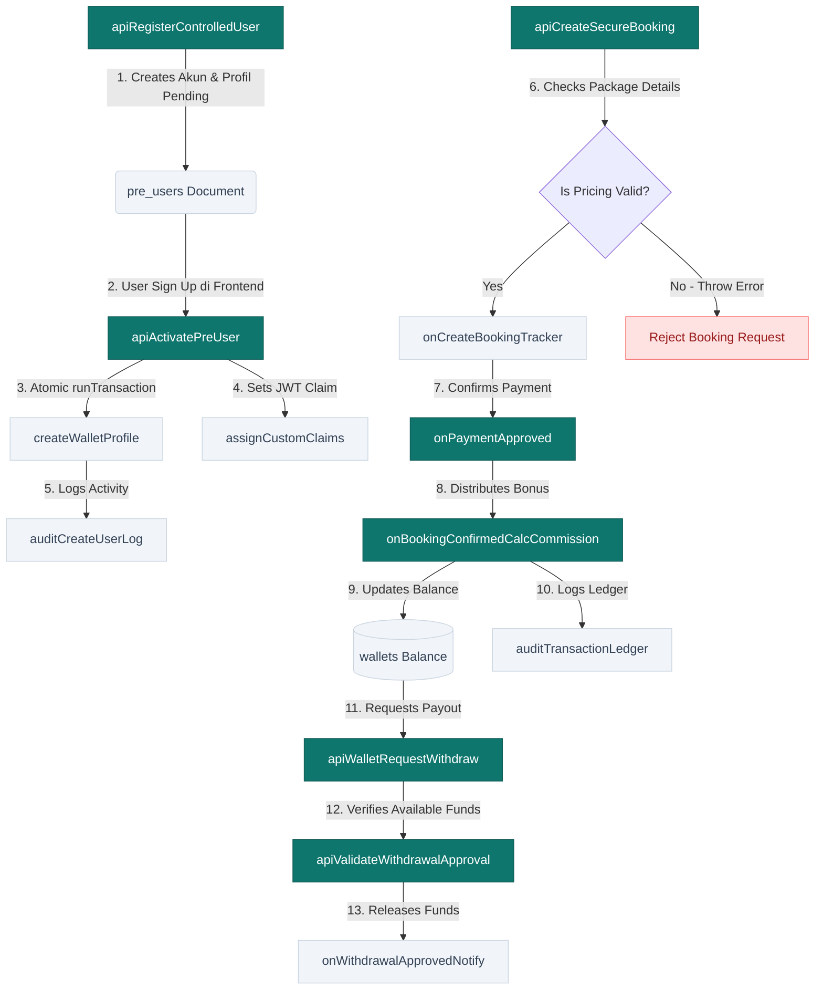

# UMAROH ERP PLATFORM - BACKEND DEVELOPMENT PLAN
## ROADMAP STRATEGIS, ARSITEKTUR INTEGRASI & PANDUAN IMPLEMENTASI CLOUD FUNCTIONS
**Target Sistem:** Serverless Backend (Q3-Q4 2026)  
**Disusun Oleh:** Chief Software Architect, Enterprise Backend Architect, Firebase Expert, DevOps Engineer, QA Lead, dan Technical Project Manager  
**Status Dokumen:** APPROVED & REGISTERED IN DEVELOPMENT ARCHIVES  
**Klasifikasi:** CONFIDENTIAL / DEV-OPS ACUAN IMPLEMENTASI  

---

## DAFTAR ISI
- [BAB 1: Backend Development Roadmap](#bab-1-backend-development-roadmap)
- [BAB 2: Cloud Function Dependency Map](#bab-2-cloud-function-dependency-map)
- [BAB 3: Daftar Cloud Functions (Spesifikasi Teknis)](#bab-3-daftar-cloud-functions-spesifikasi-teknis)
- [BAB 4: Implementasi per Sprint](#bab-4-implementasi-per-sprint)
- [BAB 5: Testing Plan (Quality Assurance)](#bab-5-testing-plan-quality-assurance)
- [BAB 6: Deployment Plan & Pipeline](#bab-6-deployment-plan--pipeline)
- [BAB 7: Monitoring & Telemetri](#bab-7-monitoring--telemetri)
- [BAB 8: Logging Standard Specification](#bab-8-logging-standard-specification)
- [BAB 9: Rollback Strategy & Disaster Recovery](#bab-9-rollback-strategy--disaster-recovery)
- [BAB 10: Definition of Done (DoD)](#bab-10-definition-of-done-dod)

---

## BAB 1: BACKEND DEVELOPMENT ROADMAP

Pengembangan dan migrasi backend Umaroh SaaS dikelompokkan ke dalam 8 Sprint terstruktur dengan total durasi 16 minggu menggunakan **Strangler Fig Pattern**. Hal ini menjamin stabilitas fungsionalitas front-end yang sudah berjalan (*backward compatibility*) serta meminimalkan risiko waktu henti (*zero downtime*).

```
  S1-S2 (Auth/ID) ──► S3-S4 (Wallet) ──► S5-S6 (Booking) ──► S7-S8 (Finance/Vendor)
  [Pondasi Inti]      [Data Keuangan]     [Alur Manifes]      [Integrasi Mitra/Mitra]
```

| Sprint | Modul / Service | Fokus Utama & Tujuan | Estimasi Waktu | Dependency | Risiko Utama | Kompleksitas |
| :--- | :--- | :--- | :--- | :--- | :--- | :--- |
| **Sprint 1** | **Identity Service** | Provisi user terkontrol, aktivasi profil `pre_users` ke `users/{uid}`, dan set Custom Claims. | 2 Minggu | Tidak ada | Konflik Auth Token di level browser klien. | Medium |
| **Sprint 2** | **Wallet Service** | Ledger saldo keuangan mitra, penambahan & pengurangan saldo, rekap histori transaksi, pencegahan manipulasi saldo klien. | 2 Minggu | Sprint 1 | Kegagalan sinkronisasi atomisitas transaksi Firestore. | Tinggi |
| **Sprint 3** | **Booking Service** | Invoice generator otomatis, validasi harga paket langsung dari master (anti-tampering), alokasi kode booking unik. | 2 Minggu | Sprint 1, 2 | Perubahan skema data manifest jemaah secara dinamis. | Tinggi |
| **Sprint 4** | **Finance Service** | Verifikasi cicilan pembayaran jemaah, kalkulasi komisi kemitraan multi-tier (MLM), disbursement saldo penarikan (WD). | 2 Minggu | Sprint 2, 3 | Kegagalan perhitungan nilai komisi akibat delay database write. | Tinggi |
| **Sprint 5** | **Vendor Service** | Sinkronisasi kuota kamar hotel Mekkah/Madinah, alokasi kursi maskapai penerbangan, dan update manifest vendor terintegrasi. | 2 Minggu | Sprint 3 | Race condition saat lock kuota di detik yang sama. | Medium |
| **Sprint 6** | **Notification Service** | Pengiriman status logistik perlengkapan koper, SMS/WhatsApp imigrasi visa jemaah via Gateway pihak ketiga. | 2 Minggu | Sprint 3, 5 | Latensi API gateway vendor dan kuota limits. | Rendah |
| **Sprint 7** | **Reporting Service** | Ekspor laporan berkala keuangan, manifest keberangkatan, audit vendor cost (PDF/Excel streaming). | 2 Minggu | Sprint 4, 5 | Penggunaan memori tinggi saat bundling dataset jemaah masif. | Medium |
| **Sprint 8** | **AI Service** | Integrasi model cerdas Gemini untuk optimasi copywriting materi marketing mitra & analisa audit anomali dokumen jemaah. | 2 Minggu | Sprint 1, 3 | Over-billing akibat konsumsi token API yang tidak dibatasi. | Medium |

---

## BAB 2: CLOUD FUNCTION DEPENDENCY MAP

Seluruh fungsionalitas Cloud Functions dirancang saling terhubung untuk membentuk satu rantai alur kerja yang kokoh, mulai dari pembentukan user hingga pelaporan keuangan akhir.

### A. Diagram Hubungan Dependensi Alur Sistem (Mermaid Flowchart)



### B. Deskripsi Dependensi Modul:
1. **Pondasi Otentikasi (`apiRegisterControlledUser`):** Menjadi hulu utama seluruh transaksi. Tanpa adanya verifikasi data di `pre_users`, jemaah/mitra baru tidak dapat memicu fungsi transaksional lainnya karena token klaim peran (*Custom Claims*) belum terisi.
2. **Ketergantungan Keuangan (`createWallet` & `onBookingConfirmedCalcCommission`):** Fungsi pembagian komisi tidak dapat berjalan sebelum dompet digital (`wallets`) terdaftar secara sempurna pada proses aktivasi user.
3. **Ketergantungan Logistik (`onCreateBookingTracker`):** Pengiriman koper, pengurusan paspor, dan penerbitan visa jemaah mutlak bergantung pada hasil kembalian instan dari status pemesanan terkonfirmasi di `apiCreateSecureBooking`.

---

## BAB 3: DAFTAR CLOUD FUNCTIONS (SPESIFIKASI TEKNIS)

Berikut spesifikasi teknis lengkap dari seluruh fungsi awan (*Cloud Functions*) yang akan diimplementasikan:

### A. Tabel Spesifikasi Cloud Functions (Auth & Wallet Modul)

| Kriteria / Properti | `apiRegisterControlledUser` | `apiActivatePreUser` | `onBookingConfirmedCalcCommission` | `apiWalletRequestWithdraw` |
| :--- | :--- | :--- | :--- | :--- |
| **Jenis Trigger** | HTTPS Callable | HTTPS Callable | Firestore Trigger (`onUpdate` bookings) | HTTPS Callable |
| **HTTPS Callable** | Ya | Ya | Tidak (Internal Trigger) | Ya |
| **Input Schema** | `{ email: string, name: string, role: string, uplineId?: string }` | `{ email: string, token: string }` | `change: { before: Document, after: Document }` | `{ bankName: string, accountNumber: string, amount: number }` |
| **Output Schema** | `{ success: boolean, tempId: string }` | `{ success: boolean, role: string, walletCreated: boolean }` | `{ processed: boolean, distributedTotal: number }` | `{ txId: string, status: string, remainingBalance: number }` |
| **Firestore Collection**| `pre_users`, `pendaftaran_mitra` | `pre_users` -> `users`, `wallets` | `bookings`, `wallets`, `transactions` | `wallets`, `transactions` |
| **Permission Rule** | Admin / Owner Only (JWT Claim Check) | Public Sign-In User with valid token | Service Account (Admin Privileges) | Authenticated Mitra (JWT Claim Check) |
| **Error Handling** | `ALREADY_EXISTS`, `INVALID_ARGUMENT` | `NOT_FOUND`, `TRANSACTION_FAILED` | Safe Log with retry-limits logic | `INSUFFICIENT_FUNDS`, `INVALID_BANK` |
| **Retry Policy** | No (Client-side retry) | No (Immediate notification) | Yes (Exponential backoff) | No (Atomic balance verification) |
| **Idempotency Key** | None | Yes (Email as unique match) | Yes (Booking ID + Payment ID) | Yes (Transaction UUID generator) |
| **Logging Level** | INFO | AUDIT | CRITICAL | AUDIT |
| **Priority Level** | **P1 (Mendesak)** | **P1 (Mendesak)** | **P1 (Mendesak)** | **P2 (Tinggi)** |

### B. Tabel Spesifikasi Cloud Functions (Booking & Vendor Modul)

| Kriteria / Properti | `apiCreateSecureBooking` | `onBookingStatusChangedLockStock` | `apiVerifyBookingCode` | `apiQueryGeminiAssistant` |
| :--- | :--- | :--- | :--- | :--- |
| **Jenis Trigger** | HTTPS Callable | Firestore Trigger (`onUpdate` bookings) | HTTPS Callable | HTTPS Callable |
| **HTTPS Callable** | Ya | Tidak | Ya | Ya |
| **Input Schema** | `{ paketId: string, rooms: Array, manifest: Array }` | `change: { before: Document, after: Document }` | `{ bookingCode: string, lastName: string }` | `{ prompt: string, context: string }` |
| **Output Schema** | `{ bookingId: string, invoiceCode: string }` | `{ success: boolean, lockedHotelRooms: number }` | `{ valid: boolean, sessionToken: string }` | `{ copyText: string, status: string }` |
| **Firestore Collection**| `bookings`, `paket_master` | `master_hotels`, `maskapai`, `bookings` | `bookings` | `ad_campaigns` |
| **Permission Rule** | Authenticated Mitra / Jemaah | Service Account (Admin Privileges) | Public / Anonymous Access | Authenticated Mitra / Marketing Staff |
| **Error Handling** | `OUT_OF_STOCK`, `INVALID_PRICING` | Log failures to `system_blueprint_nodes` | `INVALID_CODE`, `EXPIRED_MANIFEST` | `RATE_LIMIT_EXCEEDED`, `API_ERROR` |
| **Retry Policy** | No | Yes (Lock-state rollback) | No | No |
| **Idempotency Key** | Yes (Client-side UUID request) | Yes (Booking ID as transaction ref) | None | None |
| **Logging Level** | INFO | CRITICAL | INFO | WARNING |
| **Priority Level** | **P1 (Mendesak)** | **P2 (Tinggi)** | **P2 (Tinggi)** | **P3 (Rendah)** |

---

## BAB 4: IMPLEMENTASI PER SPRINT

Rencana penugasan rilis (*release assignment*) fungsi secara bertahap pada setiap sprint pengembangan:

```
[SPRINT 1] ──► [SPRINT 2] ──► [SPRINT 3] ──► [SPRINT 4] ──► [SPRINT 5] ──► [SPRINT 6/7/8]
Auth & Profile   Dompet & Mutasi  Invoice & Booking Komisi & Cicilan  Vendor & Kuota  Logistik & AI
```

### SPRINT 1: Pondasi Identitas & Aktivasi Pengguna
* **`apiRegisterControlledUser` (Callable):** Admin utama mendaftarkan data pengguna baru. Fungsi membuat data bayangan di collection `pre_users`.
* **`apiActivatePreUser` (Callable):** User baru sign-up di web. Fungsi mendeteksi kecocokan email, mendaftarkan profil final di `users/{uid}`, menghapus entri lama di `pre_users`, lalu memanggil fungsi pembuatan dompet.
* **`createWalletProfile` (Internal Helper):** Membuat dokumen dompet kosong `wallets/{uid}` dengan saldo Rp 0.
* **`assignCustomClaims` (Internal Helper):** Membaca peran dari data pre_user, dan menyematkan parameter `role` ke dalam JWT token pengguna via Firebase Auth Admin SDK.
* **`auditCreateUser` (Trigger):** Menangkap event sukses registrasi dan menyalin histori audit pendaftaran ke tabel logs.

### SPRINT 2: Ledger Keuangan & Dompet Digital
* **`apiQueryWalletBalance` (Callable):** Pengambilan sisa saldo dompet secara real-time yang memotong data kalkulasi dari server langsung (bukan input manipulatif browser).
* **`apiWalletRequestWithdraw` (Callable):** Mengajukan pencairan dana. Memeriksa sisa saldo yang tersedia, dan membekukan sementara dana yang ditarik (*Lock balance*).
* **`onWithdrawalCreatedRecordLedger` (Trigger):** Menulis log debit penarikan dana di collection `transactions` dengan status "pending".

### SPRINT 3: Transaksi Booking & Tiket Pintar
* **`apiCreateSecureBooking` (Callable):** Menerima data pesanan paket jemaah. Backend membaca harga asli dari `paket_master` dan menghitung sisa tagihan untuk menghentikan kecurangan pengubahan harga via browser inspeksi.
* **`apiVerifyBookingCode` (Callable):** Jemaah tanpa akun login memasukkan kode booking jemaah. Backend mencocokkan manifest jemaah, dan mengembalikan token otentikasi local sementara.

### SPRINT 4: Komisi Kemitraan (MLM) & Cicilan Pembayaran
* **`onBookingPaymentConfirmed` (Trigger):** Finance menyetujui transaksi cicilan DP di panel. Fungsi ini secara dinamis memperbarui persentase progres bayar invoice jemaah.
* **`onBookingConfirmedCalcCommission` (Trigger):** Terpicu dari perubahan status booking "approved". Fungsi ini menghitung porsi komisi mitra perekrut serta bonus komisi upline tingkat atasnya (Multi-level), menulis kredit saldo ke `wallets/{mitraId}` masing-masing, dan mencatat transaksi bertipe "bonus" secara atomic.

### SPRINT 5: Procurement & Alokasi Vendor
* **`onBookingStatusChangedLockStock` (Trigger):** Mengunci kamar di `master_hotels` dan mengurangi satu kuota kursi penerbangan di `maskapai` saat status booking berubah menjadi aktif untuk menghindari *overselling*.

### SPRINT 6: Logistik & Notifikasi Otomatis
* **`onBookingConfirmedInitTracker` (Trigger):** Otomatis membuat tracker bagasi di `tracker_jamaah` untuk penanganan cargo kain ihram dan koper.
* **`onNotificationCreatedSendGateway` (Trigger):** Terpicu saat data di collection `notifications` terisi, lalu menembakkan pesan WhatsApp konfirmasi keberangkatan ke nomor jemaah.

### SPRINT 7: Reporting Engine Server-Side
* **`apiGenerateFinancialReport` (Callable):** Mengompilasi ringkasan data debit/kredit bulanan dari `transactions` dan menyajikan format streaming file Excel langsung ke komputer admin.
* **`apiGenerateFlightManifestPdf` (Callable):** Mengambil manifest maskapai dan menghasilkan lembar PDF laporan manifes resmi.

### SPRINT 8: AI Integration (Gemini Engine)
* **`apiQueryGeminiAssistant` (Callable):** Menyembunyikan Gemini API key di sisi server Express dan memproksi penulisan materi promosi travel umroh untuk para staf pemasaran mitra.

---

## BAB 5: TESTING PLAN (QUALITY ASSURANCE)

Setiap fungsi awan yang dikembangkan wajib melewati serangkaian uji kualitas berlapis sebelum dinyatakan layak rilis ke lingkungan Staging dan Production.

```
┌────────────────────────────────────────────────────────┐
│                      Unit Testing                      │
│        (Mock Firestore, Firebase Functions Test)       │
└───────────────────────────┬────────────────────────────┘
                            │ (Passed)
                            ▼
┌────────────────────────────────────────────────────────┐
│                  Integration Testing                   │
│             (Firebase Local Emulator Suite)            │
└───────────────────────────┬────────────────────────────┘
                            │ (Passed)
                            ▼
┌────────────────────────────────────────────────────────┐
│             Security, Load, & Rollback Test            │
│               (Locust, Firestore Rules Rules)          │
└────────────────────────────────────────────────────────┘
```

### A. Alur Pengujian Kualitas Berlapis:
1. **Unit Testing (Fokus: Logika Matematika & Validasi Skema):**
   * Menggunakan framework Jest dan `firebase-functions-test`.
   * Meniru (*mock*) database Firestore untuk memverifikasi kebenaran formula matematika pembagian komisi MLM di `onBookingConfirmedCalcCommission`.
2. **Integration Testing (Fokus: Interaksi Database):**
   * Menggunakan **Firebase Local Emulator Suite** (Emulator Auth, Firestore, Storage, dan Functions).
   * Mensimulasikan siklus hidup penuh pendaftaran: Pemicuan `apiRegisterControlledUser` -> Penulisan data di emulator Firestore -> Login Google emulator -> Pemicuan `apiActivatePreUser` -> Verifikasi saldo `wallets` baru di Firestore emulator.
3. **Security Testing (Fokus: Kebocoran Data):**
   * Membuka koneksi klien palsu (*anonymous connection*) untuk mencoba menulis data saldo ke `wallets/{uid}` secara langsung guna memastikan aturan keamanan `firestore.rules` memblokir akses tulis ilegal klien dengan respon `Permission Denied`.
4. **Performance & Load Testing (Fokus: Latensi & Cold Start):**
   * Menggunakan pustaka **Locust** untuk mensimulasikan 500 koneksi bersamaan yang memanggil fungsi `apiVerifyBookingCode` guna mendeteksi latensi cold-start, serta mengukur batas penggunaan memori.
5. **Rollback Testing (Fokus: Kegagalan Jaringan):**
   * Menyuntikkan kesalahan (*fault injection*) di tengah jalannya proses transfer komisi multi-level (misal: memutus koneksi database saat penulisan dompet mitra kedua sedang berlangsung) untuk memverifikasi bahwa `runTransaction` membatalkan seluruh operasi (*rollback*) dan mengembalikan saldo dompet mitra pertama ke keadaan semula tanpa kehilangan uang.

---

## BAB 6: DEPLOYMENT PLAN & PIPELINE

Platform Umaroh menerapkan strategi integrasi berkelanjutan (*CI/CD Pipeline*) untuk meminimalkan intervensi manual dan menjamin kualitas kode di setiap tahapan lingkungan.

### A. Arsitektur Pipeline deployment Berkelanjutan:

```mermaid
gitGraph
    commit id: "Initial stable"
    branch develop
    checkout develop
    commit id: "Sprint 1 Feature"
    commit id: "Bugfix Login"
    branch staging
    checkout staging
    merge develop id: "Deploy Staging"
    commit id: "QA Verifikasi"
    checkout main
    merge staging id: "Production Release"
```

### B. Tahapan Alur Rilis Pipeline:
1. **Tahap Pengembangan (Development Environment):**
   * Developer melakukan commit kode fitur backend baru ke cabang `develop`.
   * CI Pipeline (GitHub Actions) menjalankan linter dan unit testing lokal secara otomatis.
2. **Tahap Pengujian (Staging Environment):**
   * Penggabungan kode ke cabang `staging` memicu build Docker otomatis dan melakukan deploy aset Cloud Functions baru ke proyek Firebase Staging (`umaroh-erp-staging`).
   * Tim QA menjalankan Integration Test suite dan Security Rules audit.
3. **Tahap Rilis (Production Environment):**
   * Setelah diverifikasi bebas dari bug, branch `staging` di-merge ke branch `main` (Production).
   * Pipeline melakukan deploy bertahap menggunakan metode **Canary Deployment** (mengarahkan 10% lalu lintas ke versi fungsi baru terlebih dahulu, kemudian naik secara bertahap ke 100% setelah 30 menit pemantauan nihil error).

---

## BAB 7: MONITORING & TELEMETRI

Sistem pemantauan didasarkan pada Google Cloud Logging dan Cloud Monitoring dashboard dengan metrik khusus yang mendeteksi segala keanehan server secara real-time.

```
┌────────────────────────────────────────────────────────┐
│                   Google Cloud Logging                 │
│         (Mendeteksi Error, Warn, & Fatal Logs)         │
└───────────────────────────┬────────────────────────────┘
                            │
                            ▼
┌────────────────────────────────────────────────────────┐
│                Cloud Monitoring Alerting               │
│     (Pemberitahuan Instan Slack/Email saat Error >1%)  │
└───────────────────────────┬────────────────────────────┘
                            │
                            ▼
┌────────────────────────────────────────────────────────┐
│                  Siklus Perbaikan Cepat                │
│    (Auto-scaling, Rollback Canary, Memory Adjust)      │
└────────────────────────────────────────────────────────┘
```

### A. Metrik Utama Pemantauan:
* **Cold Start Latency:** Pemantauan terhadap durasi inisialisasi awal Cloud Functions. Jika cold-start fungsi krusial (seperti `apiVerifyBookingCode`) melebihi 2.5 detik, ubah parameter instans minimum (`minInstances: 1`) pada konfigurasi `index.ts`.
* **Firestore Read/Write Rates:** Mencegah lonjakan tagihan database dengan mengawasi kueri melingkar (*infinite loop loops*) akibat kesalahan logika dalam trigger `onUpdate` yang menulis kembali ke dokumen pemicu asalnya.
* **Error Rate Metrics:** Mengatur ambang batas (*alerting threshold*) pada dashboard Cloud Monitoring. Jika persentase error pada fungsi transaksi finansial menyentuh angka > 1% dalam kurun waktu 5 menit, sistem otomatis mengirimkan notifikasi darurat via SMS / Slack ke tim DevOps on-call.

---

## BAB 8: LOGGING STANDARD SPECIFICATION

Semua Cloud Functions wajib mematuhi skema log JSON standar terstruktur guna memudahkan penelusuran masalah di ribuan baris barisan log Google Cloud Run.

### A. Struktur Log Format JSON Terstandarisasi:
```json
{
  "timestamp": "2026-07-09T02:08:08Z",
  "level": "AUDIT",
  "serviceName": "wallet-service",
  "functionName": "apiApproveWithdrawal",
  "executor": {
    "uid": "usr_finance_99831",
    "email": "finance.auditor@umaroh.com",
    "role": "finance"
  },
  "action": "WITHDRAWAL_APPROVAL",
  "target": {
    "collection": "transactions",
    "documentId": "tx_wd_7718290",
    "amount": 25000000
  },
  "result": {
    "status": "SUCCESS",
    "oldBalance": 35000000,
    "newBalance": 10000000,
    "idempotencyKey": "idem_wd_7718290_uuid"
  }
}
```

### B. Standardisasi Level Logging:
* **INFO:** Pencatatan alur normal sistem (misal: inisialisasi modul, pembacaan konfigurasi).
* **WARNING:** Kejadian tidak biasa namun tidak merusak sistem (misal: jemaah salah memasukkan kode booking 3 kali, latensi API pihak ketiga mendekati ambang batas).
* **ERROR:** Kegagalan fungsi yang dapat diisolasi dan tidak menghentikan keseluruhan sistem (misal: pengiriman notifikasi WhatsApp gagal).
* **CRITICAL:** Kegagalan transaksi krusial yang berdampak pada finansial atau integritas data (misal: kegagalan transaksi mutasi saldo dompet).
* **AUDIT:** Log wajib yang mencatat mutasi data, otorisasi peran, dan pembuatan user demi kebutuhan pelaporan audit kepatuhan tahunan.

---

## BAB 9: ROLLBACK STRATEGY & DISASTER RECOVERY

Mitigasi bencana dirancang dengan pendekatan pemulihan cepat untuk menghindari kerugian finansial pengguna.

### A. Protokol Penanganan Kegagalan Rilis:

```
[Deteksi Error Pasca Rilis] ──► [Aktifkan Mode Pemeliharaan] ──► [Rollback Versi Fungsi]
                                                                        │
                                                                        ▼
[Perbaiki Skema Data Gagal] ◄── [Jalankan Script Recovery] ◄── [Kembalikan Snapshot DB]
```

### B. Langkah Detail Mitigasi Kegagalan:
1. **Kegagalan Fungsi Finansial (Contoh: `onBookingConfirmedCalcCommission` Error):**
   * *Gejala:* Terjadi selisih saldo komisi atau data transaksi berlipat ganda.
   * *Tindakan 1 (Kill Switch):* Jalankan perintah penonaktifan darurat fungsi trigger via Firebase CLI:
     ```bash
     firebase functions:config:set wallet.maintenance=true
     ```
   * *Tindakan 2 (Rollback):* Lakukan rollback instan versi Cloud Functions di Google Cloud Console ke revisi nomor sebelumnya (Revert Commit).
   * *Tindakan 3 (Data Recovery):* Jalankan script recovery server-side khusus (`scripts/reconcile-ledger.ts`) yang membaca histori backup transaksi jemaah dan menyinkronkan ulang saldo wallet mitra ke nilai yang benar berdasarkan invoice pembayaran.
2. **Kegagalan Perubahan Skema Firestore (Contoh: `bookings` Fields Mismatch):**
   * *Gejala:* Sisi klien crash karena ketidakcocokan tipe data masukan baru.
   * *Tindakan:* Aktifkan skema *Backward Compatibility Layer* pada backend Express untuk mengonversi properti data format lama secara otomatis di memori sebelum disajikan ke aplikasi klien React.

---

## BAB 10: DEFINITION OF DONE (DoD)

Setiap siklus Sprint pengembangan backend baru dinyatakan selesai (*DONE*) secara resmi hanya apabila telah memenuhi seluruh kriteria ketat pada lembar checklist di bawah ini:

### Lembar Pemeriksaan Kepatuhan Pengkodean (DoD Checklist)

* [ ] **Zero Compile Error:** Kode backend berhasil dikompilasi tanpa ada peringatan linting (*eslint*) atau kegagalan tipe data TypeScript (`tsc` compile pass).
* [ ] **100% Emulator Suite Verified:** Seluruh alur fungsi terbukti berjalan sempurna di dalam lingkungan simulasi lokal Firebase Emulator Suite.
* [ ] **Security Validation Pass:** Aturan keamanan `firestore.rules` dan `storage.rules` lolos uji verifikasi penetrasi dan memblokir seluruh manipulasi data langsung dari client-side.
* [ ] **Idempotency Check:** Fungsi finansial krusial (terutama transfer komisi dan penarikan) diuji 3 kali dengan input parameter identik dan terbukti hanya menghasilkan satu efek transaksi unik saja (mencegah *double credit/debit*).
* [ ] **Zero Memory Leak:** Fungsi lolos uji ketahanan memori pasca simulasi Locust beban kerja tinggi (nihil indikasi memori terus naik).
* [ ] **Audit Logs Integrated:** Log bertipe `AUDIT` dan `CRITICAL` terbukti terkirim secara berkesinambungan ke Cloud Logging dengan data pelaksana yang lengkap.
* [ ] **Backward Compatibility OK:** Aplikasi web klien versi lama tetap dapat melakukan transaksi tanpa crash pasca perubahan rilis backend baru.
* [ ] **Documentation Sync:** Dokumentasi teknis API pada repositori backend diperbarui, dan lembar log perubahan (*changelog*) didokumentasikan di file proyek.

---
*Dokumen Rencana Pembangunan Backend ini menjadi panduan wajib bagi seluruh jajaran developer Umaroh SaaS ERP.*
