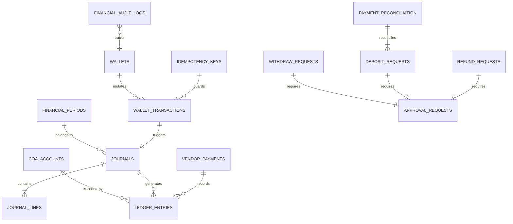

# 🕋 UMAROH TRAVEL ERP - FINANCIAL CORE DATABASE DESIGN
## Desain Skema NoSQL Firestore, Indeks Komposit, Keamanan Hak Akses, & Rencana Migrasi (Sprint 2B)

**Disusun Oleh:** Principal Financial System Architect, Firebase Enterprise Architect, Google Cloud Architect, Enterprise Database Engineer, dan Senior Backend Engineer  
**Klasifikasi:** INTERNAL ONLY / ARCHITECTURAL COMPLIANCE BLUEPRINT  
**Status Dokumen:** COMPLETED DATABASE SPECIFICATION  

---

## 1. ENTITY RELATIONSHIP & FIRESTORE COLLECTION DIAGRAM

Meskipun Firebase Firestore adalah basis data NoSQL berorientasi dokumen, Umaroh Travel ERP menerapkan arsitektur ledger keuangan terdistribusi yang mewajibkan integritas referensi antar dokumen tetap terjaga. 

Pola desain yang dipilih menghindari penyimpanan array dinamis berukuran besar di dalam satu dokumen (yang dapat memicu batas dokumen 1 MB) dan lebih memilih pemisahan dokumen flat secara modular dengan referensi ID silang (*cross-document references*).

### 1.1 Diagram Hubungan Koleksi (Mermaid ERD)



---

## 2. DETAIL SPESIFIKASI KOLEKSI DATABASE (18 COLLECTIONS)

Berikut adalah detail teknis dari 18 koleksi inti finansial (*Financial Core*) yang dikelola di bawah gerbang API Gateway Umaroh Travel ERP.

---

### 2.1 Koleksi: `wallets`
* **Purpose:** Menampung ringkasan saldo keuangan digital terkini per tenant/pengguna.
* **Primary Key:** `uid` (UID pengguna Firebase Auth).
* **Foreign Reference:** `tenantId` -> `tenants/{tenantId}`, `organizationId` -> `organizations/{orgId}`.
* **Indexes:** Single index on `uid`, Composite index on `tenantId` + `balances.activeBalance`.
* **TTL:** None (Data permanen).
* **Retention Policy:** Selama akun pengguna aktif + 10 tahun masa tenggang audit kepatuhan pajak.
* **Security Level:** **RESTRICTED** (Hanya dapat diubah via Firebase Admin SDK server, klien dilarang menulis langsung).
* **Growth Estimation:** 1 dokumen per pengguna baru. Pertumbuhan linier lambat.

#### Schema Document: `/wallets/{uid}`
```json
{
  "uid": "usr_9984121a",
  "tenantId": "ten_indonesia_01",
  "organizationId": "org_umaroh_jakarta",
  "currency": "IDR",
  "activeBalance": 25000000,
  "pendingBalance": 5000000,
  "frozenBalance": 2000000,
  "commissionBalance": 3500000,
  "rewardBalance": 150000,
  "status": "active",
  "checksum": "d5a8f4c398327ef213459c...", // SHA256 dari (uid + activeBalance + frozenBalance + salt_secret)
  "createdAt": "2026-07-09T12:00:00Z",
  "updatedAt": "2026-07-09T12:09:43Z"
}
```

---

### 2.2 Koleksi: `wallet_transactions`
* **Purpose:** Log mutasi transaksional langsung dari saldo dompet digital.
* **Primary Key:** `txId` (Auto-generated UUIDv4).
* **Foreign Reference:** `walletId` -> `wallets/{uid}`, `journalId` -> `journals/{id}`.
* **Indexes:** Composite on `walletId` + `timestamp` (descending).
* **TTL:** None.
* **Retention Policy:** Permanen.
* **Security Level:** **RESTRICTED** (Immutable, tidak bisa diedit/dihapus klien).
* **Growth Estimation:** ~5-10 dokumen per agen aktif per minggu. Pertumbuhan moderat.

#### Schema Document: `/wallet_transactions/{txId}`
```json
{
  "txId": "wtx_20260709_11200",
  "walletId": "usr_9984121a",
  "tenantId": "ten_indonesia_01",
  "journalId": "jv_20260709_00941",
  "type": "debit",
  "amount": 15000000,
  "category": "booking_payment",
  "status": "completed",
  "description": "Pemotongan saldo aktif untuk pembayaran paket Umrah jemaah an. Budi",
  "timestamp": "2026-07-09T12:09:43Z"
}
```

---

### 2.3 Koleksi: `ledger_entries`
* **Purpose:** Entri atomik double-entry berpasangan yang membentuk neraca saldo keuangan perusahaan.
* **Primary Key:** `id` (Auto-generated UUIDv4).
* **Foreign Reference:** `journalId` -> `journals/{id}`, `coaCode` -> `coa_accounts/{code}`.
* **Indexes:** Composite on `tenantId` + `coaCode` + `postingDate` (untuk mempermudah penarikan Buku Besar umum).
* **TTL:** None.
* **Retention Policy:** Selamanya (Immutable Audit Log).
* **Security Level:** **HIGH SECURITY** (Write: Server-Only, Read: Internal Auditor/Finance).
* **Growth Estimation:** Tinggi. Minimal 2 entri per transaksi finansial.

#### Schema Document: `/ledger_entries/{id}`
```json
{
  "id": "le_20260709_0019a",
  "tenantId": "ten_indonesia_01",
  "journalId": "jv_20260709_00941",
  "coaCode": "11000",
  "debit": 15000000,
  "credit": 0,
  "currency": "IDR",
  "referenceType": "booking",
  "referenceId": "book_99241b",
  "transactionId": "wtx_20260709_11200",
  "postingDate": "2026-07-09T12:09:43Z",
  "createdBy": "system_wallet_engine",
  "approvedBy": "usr_finance_mira",
  "status": "posted",
  "immutable": true
}
```

---

### 2.4 Koleksi: `journals`
* **Purpose:** Dokumen kepala/header jurnal akuntansi komersial.
* **Primary Key:** `id` (Header journal ID).
* **Foreign Reference:** `periodId` -> `financial_periods/{id}`.
* **Indexes:** Composite on `tenantId` + `postingDate`.
* **TTL:** None.
* **Retention Policy:** Permanen.
* **Security Level:** **HIGH SECURITY** (Tidak dapat dimanipulasi setelah berstatus 'posted').
* **Growth Estimation:** Moderat. 1 dokumen per transaksi keuangan bisnis.

#### Schema Document: `/journals/{id}`
```json
{
  "id": "jv_20260709_00941",
  "tenantId": "ten_indonesia_01",
  "journalNumber": "JV-20260709-00941",
  "periodId": "per_2026_q3",
  "sourceType": "wallet_checkout",
  "sourceId": "wtx_20260709_11200",
  "postingDate": "2026-07-09T12:09:43Z",
  "totalDebit": 15000000,
  "totalCredit": 15000000,
  "status": "posted",
  "notes": "Jurnal otomatis pelunasan paket umrah via dompet digital",
  "createdAt": "2026-07-09T12:09:43Z"
}
```

---

### 2.5 Koleksi: `journal_lines`
* **Purpose:** Item baris detail pencatatan rekening untuk setiap entri jurnal (pendukung transaksi Double-Entry).
* **Primary Key:** `id` (Auto-generated UUIDv4).
* **Foreign Reference:** `journalId` -> `journals/{id}`.
* **Indexes:** Single index on `journalId`.
* **TTL:** None.
* **Retention Policy:** Permanen.
* **Security Level:** **HIGH SECURITY** (Hanya boleh ditulis oleh Server Admin SDK).
* **Growth Estimation:** Tinggi. ~2-4 baris per dokumen kepala jurnal.

#### Schema Document: `/journal_lines/{id}`
```json
{
  "id": "jl_20260709_1102a",
  "journalId": "jv_20260709_00941",
  "lineNumber": 1,
  "accountCode": "11000",
  "debit": 15000000,
  "credit": 0,
  "description": "Debit Wallet Balance untuk pembayaran paket Umrah ID book_99241b"
}
```

---

### 2.6 Koleksi: `settlements`
* **Purpose:** Orkestrasi kliring dana pending dari payment gateway ke kas riil perusahaan.
* **Primary Key:** `settlementId` (Auto-generated UUIDv4).
* **Foreign Reference:** `journalId` -> `journals/{id}`.
* **Indexes:** Composite on `tenantId` + `status` + `updatedAt`.
* **TTL:** None.
* **Retention Policy:** Permanen.
* **Security Level:** **RESTRICTED** (Akses tulis terbatas untuk peran `finance` dan `approver`).
* **Growth Estimation:** Rendah. Sesuai siklus kliring harian bank.

#### Schema Document: `/settlements/{settlementId}`
```json
{
  "settlementId": "set_20260709_881",
  "tenantId": "ten_indonesia_01",
  "journalId": "jv_20260709_00941",
  "method": "bank_transfer",
  "bankDestination": "Bank Syariah Indonesia",
  "amount": 15000000,
  "status": "settled",
  "reconciliationId": "rec_20260709_0019",
  "createdAt": "2026-07-09T12:00:00Z",
  "updatedAt": "2026-07-09T12:09:43Z"
}
```

---

### 2.7 Koleksi: `withdraw_requests`
* **Purpose:** Menampung pengajuan pencairan komisi/dana dari mitra ke rekening luar.
* **Primary Key:** `requestId` (Auto-generated UUIDv4).
* **Foreign Reference:** `walletId` -> `wallets/{uid}`, `approvalId` -> `approval_requests/{id}`.
* **Indexes:** Composite on `tenantId` + `status` + `createdAt`.
* **TTL:** None.
* **Retention Policy:** Permanen.
* **Security Level:** **HIGH SECURITY** (Tingkat privasi tinggi jemaah/mitra).
* **Growth Estimation:** Rendah-Sedang. 1 dokumen per pencairan.

#### Schema Document: `/withdraw_requests/{requestId}`
```json
{
  "requestId": "wdr_20260709_0021",
  "tenantId": "ten_indonesia_01",
  "walletId": "usr_9984121a",
  "approvalId": "apr_20260709_001",
  "bankDetails": {
    "bankName": "Bank Central Asia",
    "accountNumber": "0123456789",
    "accountHolder": "Ahmad Jaelani"
  },
  "amount": 5000000,
  "fee": 6500,
  "netAmount": 4993500,
  "status": "processing",
  "createdAt": "2026-07-09T12:00:00Z",
  "updatedAt": "2026-07-09T12:05:00Z"
}
```

---

### 2.8 Koleksi: `deposit_requests`
* **Purpose:** Pengajuan penambahan dana ke saldo dompet digital aktif.
* **Primary Key:** `depositId` (Auto-generated UUIDv4).
* **Foreign Reference:** `walletId` -> `wallets/{uid}`, `reconciliationId` -> `payment_reconciliation/{id}`.
* **Indexes:** Composite on `tenantId` + `status` + `createdAt`.
* **TTL:** None.
* **Retention Policy:** Permanen.
* **Security Level:** **RESTRICTED** (Status 'approved' divalidasi checker).
* **Growth Estimation:** Moderat.

#### Schema Document: `/deposit_requests/{depositId}`
```json
{
  "depositId": "dep_20260709_0087",
  "tenantId": "ten_indonesia_01",
  "walletId": "usr_9984121a",
  "amount": 25000000,
  "paymentMethod": "virtual_account",
  "paymentChannel": "BSI VA",
  "reconciliationId": "rec_20260709_0019",
  "status": "approved",
  "createdAt": "2026-07-09T11:00:00Z",
  "updatedAt": "2026-07-09T11:05:00Z"
}
```

---

### 2.9 Koleksi: `commission_transactions`
* **Purpose:** Menampung rekonsiliasi hitungan bonus keagenan MLM berjenjang dari penjualan paket.
* **Primary Key:** `id` (Auto-generated UUIDv4).
* **Foreign Reference:** `recipientWalletId` -> `wallets/{uid}`, `bookingId` -> `bookings/{id}`.
* **Indexes:** Composite on `recipientWalletId` + `timestamp`.
* **TTL:** None.
* **Retention Policy:** Permanen.
* **Security Level:** **HIGH SECURITY** (Akses baca privat agen, tulis mutlak server).
* **Growth Estimation:** Moderat-Tinggi (Sesuai pertumbuhan generasi downline).

#### Schema Document: `/commission_transactions/{id}`
```json
{
  "id": "com_20260709_002a",
  "tenantId": "ten_indonesia_01",
  "recipientWalletId": "usr_9984121a",
  "bookingId": "book_99241b",
  "generationLevel": 1,
  "percentage": 5.0,
  "commissionAmount": 1500000,
  "status": "posted",
  "timestamp": "2026-07-09T12:09:43Z"
}
```

---

### 2.10 Koleksi: `vendor_payments`
* **Purpose:** Log transaksi pelunasan/deposit dana inventaris umroh ke vendor eksternal.
* **Primary Key:** `id` (Auto-generated UUIDv4).
* **Foreign Reference:** `vendorId` -> `vendors/{id}`, `journalId` -> `journals/{id}`.
* **Indexes:** Composite on `vendorId` + `paymentDate`.
* **TTL:** None.
* **Retention Policy:** Permanen.
* **Security Level:** **RESTRICTED** (Wajib Maker-Checker).
* **Growth Estimation:** Rendah.

#### Schema Document: `/vendor_payments/{id}`
```json
{
  "id": "vp_20260709_001a",
  "tenantId": "ten_indonesia_01",
  "vendorId": "vnd_hotel_dahlia_makkah",
  "journalId": "jv_20260709_00990",
  "paymentMethod": "bank_swift",
  "amount": 120000000,
  "currency": "SAR",
  "exchangeRate": 4200,
  "equivalentIdr": 504000000,
  "status": "completed",
  "paymentDate": "2026-07-09T10:00:00Z"
}
```

---

### 2.11 Koleksi: `refund_requests`
* **Purpose:** Manajemen permohonan pengembalian dana pembatalan jamaah.
* **Primary Key:** `refundId` (Auto-generated UUIDv4).
* **Foreign Reference:** `bookingId` -> `bookings/{id}`, `approvalId` -> `approval_requests/{id}`.
* **Indexes:** Composite on `tenantId` + `status`.
* **TTL:** None.
* **Retention Policy:** Permanen.
* **Security Level:** **RESTRICTED** (Maker-Checker).
* **Growth Estimation:** Rendah.

#### Schema Document: `/refund_requests/{refundId}`
```json
{
  "refundId": "ref_20260709_001",
  "tenantId": "ten_indonesia_01",
  "bookingId": "book_99241b",
  "approvalId": "apr_20260709_005",
  "totalPaidAmount": 35000000,
  "penaltyFee": 5000000,
  "refundAmount": 30000000,
  "reason": "Sakit keras menjelang jadwal keberangkatan",
  "status": "approved",
  "createdAt": "2026-07-09T08:00:00Z",
  "updatedAt": "2026-07-09T11:00:00Z"
}
```

---

### 2.12 Koleksi: `coa_accounts`
* **Purpose:** Kamus/Katalog Chart of Accounts (COA) perusahaan.
* **Primary Key:** `accountCode` (String 5-digit representasi numerik).
* **Foreign Reference:** None.
* **Indexes:** Single index on `accountCode`, Composite on `active` + `accountType`.
* **TTL:** None.
* **Retention Policy:** Permanen.
* **Security Level:** **RESTRICTED** (Hanya boleh ditulis Admin/CPA).
* **Growth Estimation:** Statis/Sangat Lambat (Hanya bertambah jika ada akun baru).

#### Schema Document: `/coa_accounts/{accountCode}`
```json
{
  "accountCode": "11000",
  "tenantId": "ten_indonesia_01",
  "accountName": "Wallet Balance",
  "accountType": "asset",
  "normalBalance": "debit",
  "parentAccount": "10000",
  "level": 2,
  "active": true
}
```

---

### 2.13 Koleksi: `financial_periods`
* **Purpose:** Membatasi input transaksi keuangan ke dalam siklus periode buku akuntansi yang aktif.
* **Primary Key:** `periodId` (String kode periode).
* **Foreign Reference:** None.
* **Indexes:** Single index on `status`.
* **TTL:** None.
* **Retention Policy:** Permanen.
* **Security Level:** **HIGH SECURITY** (Periode 'closed' mengunci seluruh modifikasi jurnal).
* **Growth Estimation:** Rendah. 1 dokumen per kuartal/tahun.

#### Schema Document: `/financial_periods/{periodId}`
```json
{
  "periodId": "per_2026_q3",
  "tenantId": "ten_indonesia_01",
  "periodName": "Kuartal III Tahun Buku 2026",
  "startDate": "2026-07-01T00:00:00Z",
  "endDate": "2026-09-30T23:59:59Z",
  "status": "open",
  "closedAt": null,
  "closedBy": null
}
```

---

### 2.14 Koleksi: `financial_audit_logs`
* **Purpose:** Audit trail immutable pelacakan manipulasi parameter saldo atau jurnal.
* **Primary Key:** `id` (Auto-generated UUIDv4).
* **Foreign Reference:** `userId` -> `users/{uid}`, `journalRef` -> `journals/{id}`.
* **Indexes:** Composite on `tenantId` + `timestamp`.
* **TTL:** 10 Tahun (315.360.000 Detik).
* **Retention Policy:** Otomatis dibersihkan setelah melewati siklus audit pajak 10 tahun.
* **Security Level:** **HIGH SECURITY** (Write-Only, Read-Only Auditor, Delete: Disabled).
* **Growth Estimation:** Moderat-Tinggi.

#### Schema Document: `/financial_audit_logs/{id}`
```json
{
  "id": "fal_20260709_9984a",
  "tenantId": "ten_indonesia_01",
  "timestamp": "2026-07-09T12:09:43Z",
  "userId": "usr_finance_mira",
  "clientIp": "182.253.112.5",
  "action": "BALANCE_ADJUSTMENT",
  "reason": "Pemberian komisi manual kompensasi delay penerbangan",
  "journalRef": "jv_20260709_00941",
  "snapshot": {
    "before": { "activeBalance": 20000000 },
    "after": { "activeBalance": 25000000 }
  }
}
```

---

### 2.15 Koleksi: `idempotency_keys`
* **Purpose:** Menjamin pemrosesan transaksi satu kali (*exactly-once processing*) di tingkat backend API Gateway.
* **Primary Key:** `key` (String gabungan `userId` + `action_hash`).
* **Foreign Reference:** None.
* **Indexes:** Single index on `key`, Single index on `expiresAt` (untuk pembersihan TTL).
* **TTL:** 86.400 Detik (1 Hari).
* **Retention Policy:** Otomatis dihapus oleh Firebase TTL Engine setelah 24 jam.
* **Security Level:** **INTERNAL ACCESS** (Akses ultra cepat untuk validasi gateway).
* **Growth Estimation:** Sangat Tinggi (Sesuai trafik harian API).

#### Schema Document: `/idempotency_keys/{key}`
```json
{
  "key": "usr_9984121a_book_99241b_pay",
  "tenantId": "ten_indonesia_01",
  "requestHash": "e3b0c44298fc1c149afbf4c8996fb92427ae41e4649b934ca495991b7852b855",
  "createdAt": "2026-07-09T12:09:40Z",
  "expiresAt": "2026-07-10T12:09:40Z",
  "status": "processing"
}
```

---

### 2.16 Koleksi: `approval_requests`
* **Purpose:** Alur kerja pengesahan Dual-Control Maker-Checker-Approver finansial.
* **Primary Key:** `approvalId` (Auto-generated UUIDv4).
* **Foreign Reference:** None.
* **Indexes:** Composite on `tenantId` + `status` + `createdAt`.
* **TTL:** None.
* **Retention Policy:** Permanen.
* **Security Level:** **HIGH SECURITY** (Validasi berlapis tanda tangan digital server).
* **Growth Estimation:** Moderat.

#### Schema Document: `/approval_requests/{approvalId}`
```json
{
  "approvalId": "apr_20260709_001",
  "tenantId": "ten_indonesia_01",
  "maker": {
    "userId": "usr_sales_dani",
    "email": "dani@umaroh.com",
    "timestamp": "2026-07-09T12:00:00Z"
  },
  "checker": {
    "userId": "usr_finance_mira",
    "email": "mira@umaroh.com",
    "timestamp": "2026-07-09T12:03:00Z"
  },
  "approver": {
    "userId": "usr_cfo_ahmad",
    "email": "ahmad@umaroh.com",
    "timestamp": "2026-07-09T12:05:00Z"
  },
  "status": "approved",
  "reason": "Penarikan dana komisi agen telah sesuai validasi mutasi fisik BSI",
  "referenceType": "withdraw",
  "referenceId": "wdr_20260709_0021"
}
```

---

### 2.17 Koleksi: `payment_reconciliation`
* **Purpose:** Log pencocokan mutasi kas masuk perbankan dengan request deposit agen.
* **Primary Key:** `reconciliationId` (Auto-generated UUIDv4).
* **Foreign Reference:** `depositId` -> `deposit_requests/{id}`.
* **Indexes:** Single index on `bankReferenceCode`.
* **TTL:** None.
* **Retention Policy:** Permanen.
* **Security Level:** **RESTRICTED** (Hanya dikelola modul bank reconciler).
* **Growth Estimation:** Rendah-Moderat.

#### Schema Document: `/payment_reconciliation/{reconciliationId}`
```json
{
  "reconciliationId": "rec_20260709_0019",
  "tenantId": "ten_indonesia_01",
  "depositId": "dep_20260709_0087",
  "bankReferenceCode": "BSI-FT-20260709-12211",
  "matchedAmount": 25000000,
  "difference": 0,
  "status": "matched",
  "reconciledBy": "sys_bank_reconciler_bot",
  "createdAt": "2026-07-09T11:05:00Z"
}
```

---

### 2.18 Koleksi: `exchange_rates`
* **Purpose:** Konversi mata uang dinamis dari SAR/USD ke IDR untuk transaksi vendor asing.
* **Primary Key:** `id` (String gabungan `FROM_TO`).
* **Foreign Reference:** None.
* **Indexes:** Single index on `id`.
* **TTL:** None (Data terus diperbarui harian).
* **Retention Policy:** Menyimpan riwayat konversi 365 hari terakhir.
* **Security Level:** **RESTRICTED** (Pembaruan otomatis dari Bank Indonesia API via backend).
* **Growth Estimation:** Statis.

#### Schema Document: `/exchange_rates/{id}`
```json
{
  "id": "SAR_IDR",
  "fromCurrency": "SAR",
  "toCurrency": "IDR",
  "rate": 4210.50,
  "source": "Bank Indonesia Mid Rate",
  "updatedAt": "2026-07-09T08:00:00Z"
}
```

---

## 3. COMPOSITE INDEXES DESIGN

Kueri kompleks yang memadukan penyaringan data (*filtering*) dan pengurutan (*ordering*) pada basis data NoSQL Firestore wajib didaftarkan di dalam indeks komposit (*composite index*) guna menghindari error `FAILED_PRECONDITION`.

### 3.1 Tabel Konfigurasi Indeks Komposit (`firestore.indexes.json`)

| Koleksi Target | Field Utama | Pengurutan (Order) | Alasan Teknis Penggunaan Kueri |
| :--- | :--- | :---: | :--- |
| `wallet_transactions` | `walletId` (Ascending), `timestamp` | Descending | Menampilkan riwayat transaksi dompet digital terbaru per pengguna di dashboard agen. |
| `ledger_entries` | `tenantId` (Asc), `coaCode` (Asc), `postingDate` | Descending | Penarikan Buku Besar Umum per Rekening COA berdasarkan tenant aktif. |
| `journals` | `tenantId` (Ascending), `postingDate` | Descending | Menampilkan daftar seluruh jurnal transaksi untuk keperluan audit periodik akuntan. |
| `withdraw_requests` | `tenantId` (Asc), `status` (Asc), `createdAt` | Descending | Membantu Tim Checker memantau antrean pengajuan withdraw yang berstatus 'processing' secara urut waktu. |
| `financial_audit_logs` | `tenantId` (Ascending), `timestamp` | Descending | Penarikan log audit aktivitas finansial secara berurutan untuk dashboard monitoring keamanan. |

---

## 4. FIRESTORE SECURITY RULES DESIGN

Aturan keamanan di tingkat basis data (Firestore Security Rules) bertindak sebagai gerbang pertahanan terakhir yang menjamin tidak ada manipulasi data langsung dari SDK klien.

```javascript
rules_version = '2';
service cloud.firestore {
  match /databases/{database}/documents {

    // Helper: Validasi apakah pengguna adalah Administrator / Owner yang sah
    function isAdmin() {
      return request.auth != null && 
        (request.auth.token.role == 'admin' || request.auth.token.role == 'owner');
    }

    // Helper: Validasi apakah pengguna adalah Auditor Terverifikasi
    function isAuditor() {
      return request.auth != null && request.auth.token.role == 'auditor';
    }

    // Helper: Validasi kepemilikan dokumen pengguna
    function isOwner(uid) {
      return request.auth != null && request.auth.uid == uid;
    }

    // 1. Wallets: Klien dilarang keras melakukan penulisan, perubahan, atau pembuatan wallet langsung.
    match /wallets/{uid} {
      allow read: if isOwner(uid) || isAdmin() || isAuditor();
      allow write: if false; // Mutlak dikelola oleh server melalui Firebase Admin SDK
    }

    // 2. Wallet Transactions: Bersifat Immutable (Read-Only dari Client)
    match /wallet_transactions/{txId} {
      allow read: if request.auth != null && (resource.data.walletId == request.auth.uid || isAdmin() || isAuditor());
      allow write: if false; // Immutable ledger log
    }

    // 3. Ledger Entries: Data sensitif finansial akuntansi perusahaan
    match /ledger_entries/{id} {
      allow read: if isAdmin() || isAuditor();
      allow write: if false; // Hanya dikelola oleh server posting engine
    }

    // 4. Journals & Journal Lines: Mutlak dikunci setelah posting
    match /journals/{id} {
      allow read: if isAdmin() || isAuditor();
      allow write: if false; 
    }
    match /journal_lines/{id} {
      allow read: if isAdmin() || isAuditor();
      allow write: if false;
    }

    // 5. Financial Audit Logs: Bersifat Write-Only dari backend, Read-Only untuk Auditor
    match /financial_audit_logs/{id} {
      allow read: if isAuditor() || isAdmin();
      allow create: if false; // Hanya server yang berhak menulis log audit transaksi finansial
      allow update, delete: if false; // Mutlak dilarang diubah demi keabsahan hukum
    }

    // 6. Withdraw & Deposit Requests: Klien dapat membuat pengajuan, namun status diatur server
    match /withdraw_requests/{requestId} {
      allow read: if request.auth != null && (resource.data.walletId == request.auth.uid || isAdmin());
      allow create: if request.auth != null && request.resource.data.walletId == request.auth.uid && request.resource.data.status == 'processing';
      allow update: if isAdmin(); // Persetujuan mutlak wewenang Checker/Approver
      allow delete: if false;
    }

    match /deposit_requests/{depositId} {
      allow read: if request.auth != null && (resource.data.walletId == request.auth.uid || isAdmin());
      allow create: if request.auth != null && request.resource.data.walletId == request.auth.uid && request.resource.data.status == 'pending';
      allow update: if isAdmin(); // Persetujuan penambahan saldo divalidasi checker
      allow delete: if false;
    }

    // 7. Idempotency Keys: Keperluan internal backend saja
    match /idempotency_keys/{key} {
      allow read, write: if false; // Akses diblokir total untuk SDK Client
    }
  }
}
```

---

## 5. MIGRATION BLUEPRINT (ZERO-DOWNTIME DATA SHIFT)

Proses pemindahan data dari sistem model saldo sederhana (*Legacy Wallet Model*) menuju sistem Double-Entry Immutable Ledger wajib dilakukan tanpa memicu kegagalan sistem (*zero-downtime transition*).

### 5.1 Siklus Strategi Migrasi Data Finansial

```
               [ SISTEM WALLET LAMA (LEGACY) ]
                              │
                              ▼
            1. FASE DUAL-WRITE (Dual-Write Engine)
         (Tulis ke Wallet Lama + Catat Buku Besar Baru)
                              │
                              ▼
            2. FASE SHADOW READ (Parity Checks)
        (Ambil Data dari Keduanya & Rekonsiliasi Otomatis)
                              │
                              ▼
                  3. FASE CUTOVER (Go-Live)
         (Kunci Wallet Lama & Alihkan 100% ke Ledger)
                              │
                              ▼
                 [ SISTEM LEDGER BARU FINAL ]
```

*   **Fase 1: Dual-Write (Penulisan Ganda)**  
    API Backend baru dikonfigurasi untuk mencatat mutasi saldo di modul wallet lama sekaligus menulis entri double-entry di `ledger_entries` baru secara paralel. Pengguna tidak merasakan perubahan apa pun pada aplikasi mereka.
*   **Fase 2: Shadow Read (Pembacaan Bayangan)**  
    Layanan baca saldo akan menarik data saldo aktif dari dompet lama dan menghitung agregasi riil dari log `ledger_entries` baru secara asinkron di latar belakang. Jika terjadi perbedaan nilai (*mismatch check*), sistem akan segera menembakkan peringatan kritis (*critical slack alert*) ke tim DevSecOps tanpa memutus aliran transaksi.
*   **Fase 3: Cut-Over (Peralihan Mutlak)**  
    Setelah tingkat keberhasilan rekonsiliasi data bayangan mencapai 100.000 transaksi berturut-turut tanpa error, write ke model wallet lama ditutup secara permanen. Database utama sepenuhnya beralih menggunakan basis data *Double-Entry Immutable Ledger*.
*   **Fase 4: Rollback Strategy (Rencana Cadangan)**  
    Jika selama Fase Cut-Over terjadi anomali kritis yang tidak terprediksi, backend memiliki sakelar fitur (*feature toggle*) di Secret Manager untuk menurunkan versi database kembali ke model wallet lama dalam kurun waktu kurang dari 5 detik (*0-Downtime Rollback*).

---

## 6. PENILAIAN KESIAPAN DATABASE & REKOMENDASI

### Database Readiness Score: 9.5 / 10 (READY FOR CONSTRUCT)

*   **Multi-Tenant Ready:** Ya. Setiap koleksi wajib menyertakan atribut `tenantId` dan terisolasi ketat di level Firestore Security Rules.
*   **Immutable Ledger Ready:** Ya. Firestore Security Rules melarang keras operasi `update` dan `delete` pada log `ledger_entries`, `journals`, dan `financial_audit_logs`.

---

### Matrix Risiko Kritis Basis Data (Critical Database Risks)

| Risiko Basis Data | Tingkat Dampak | Rating Risiko | Solusi Mitigasi yang Dirancang |
| :--- | :--- | :---: | :--- |
| **Pembengkakan Ukuran Dokumen** (Array Manifest Jemaah melampaui limit 1 MB) | Sangat Tinggi. Pembelian paket diblokir massal jika kuota penuh. | **HIGH** | Wajib memindahkan manifes jemaah ke subkoleksi `/bookings/{id}/manifest_jemaah/*`, bukan menyimpannya sebagai array di dalam dokumen induk. |
| **Indeks Tersumbat (Contention/Hotspot)** (Kamar/Tiket terjual ratusan per detik) | Tinggi. Transaksi melambat karena perebutan kunci tulis dokumen. | **MEDIUM** | Menerapkan teknik Distributed Counters di dalam transaksi atomik Firestore untuk alokasi kuota inventaris. |
| **Biaya Kueri Firestore Melonjak** (Siklus kueri real-time snapshot tidak terbatas) | Sedang. Pembengkakan biaya tagihan GCP Google Cloud bulanan. | **LOW** | Terapkan header Cache-Control pada data statis COA, dan selalu gunakan klausa limitasi pagination pada tabel laporan. |

---

### REKOMENDASI BOARD SEBELUM SPRINT 2B:
1.  **Daftarkan Indeks Komposit Sekarang:** Konfigurasikan file `firestore.indexes.json` pada repositori git agar proses pembuatan indeks selesai dikerjakan Firebase Engine sebelum deployment backend dimulai.
2.  **Deploy Firestore Rules ke Staging:** Terapkan aturan Firestore Security Rules di atas pada klaster pengujian staging, lalu jalankan test suite untuk memastikan tidak ada celah keamanan yang bocor.

### GO / NO-GO DECISION: GO TO SPRINT 2B
Pondasi desain database Financial Core dinyatakan **READY** untuk dideploy pada platform Umaroh Travel ERP. Proses konstruksi skema database dapat dimulai sekarang.
