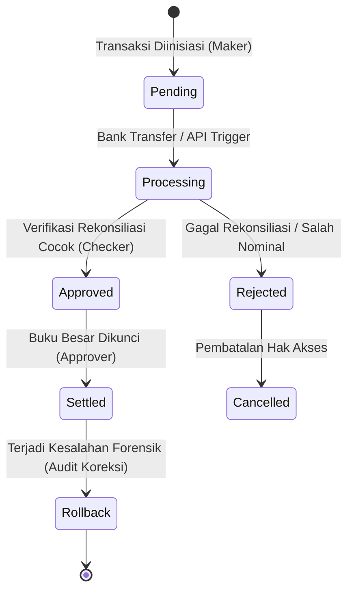
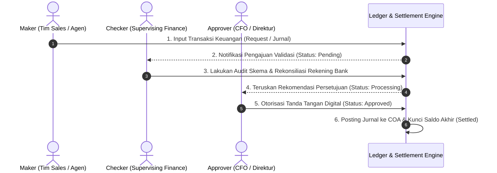
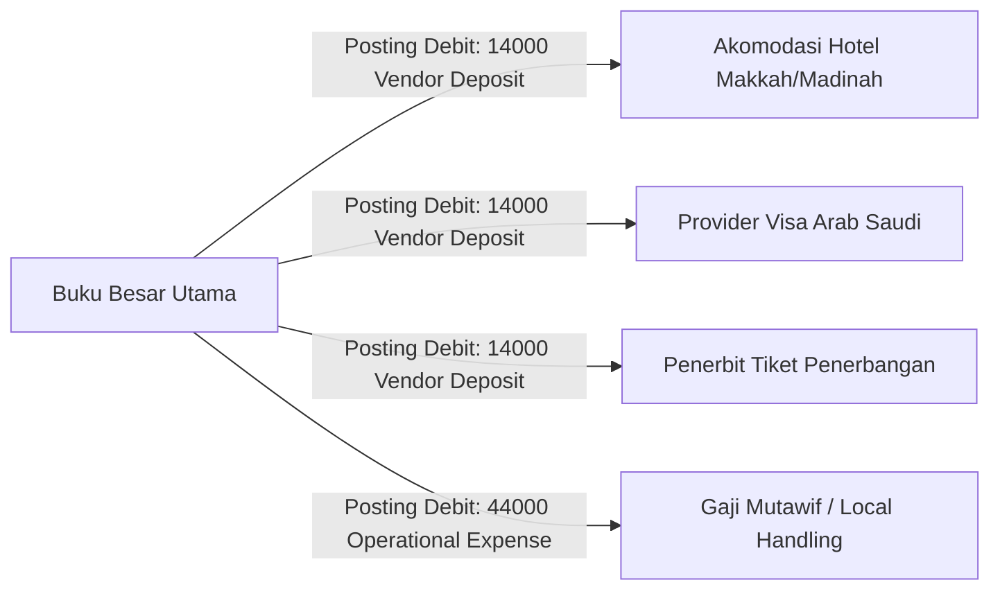
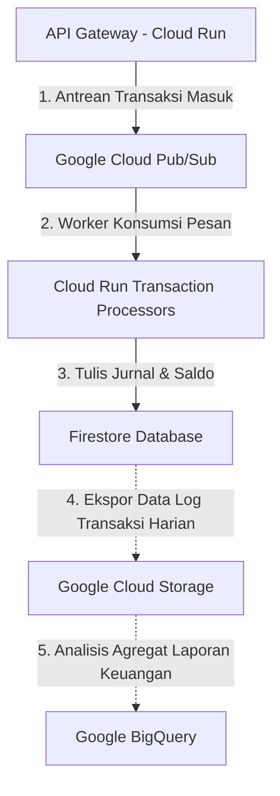

# 🕋 UMAROH TRAVEL ERP - FINANCIAL CORE BLUEPRINT
## Standar Arsitektur Keuangan, Buku Besar (Ledger), & Double-Entry Accounting (Q3 2026)

**Disusun Oleh:** Principal Financial System Architect, Enterprise ERP Architect, Google Cloud Architect, Certified Public Accountant (CPA), Enterprise Backend Engineer, dan Software Architect  
**Klasifikasi:** INTERNAL ONLY / ARCHITECTURAL COMPLIANCE BLUEPRINT  
**Status Dokumen:** COMPLETED SYSTEM SPECIFICATION  

---

## BAB 1: FINANCIAL ARCHITECTURE

Sistem keuangan Umaroh Travel ERP dirancang menggunakan prinsip **Double-Entry Accounting** yang ketat dengan arsitektur **Immutable Ledger** (buku besar tidak dapat diubah). Seluruh mutasi keuangan, baik penambahan saldo, pembayaran booking, komisi keagenan, hingga pembayaran vendor, wajib diorkestrasi melalui API Serverless yang aman. Klien dilarang keras melakukan manipulasi saldo secara langsung di database.

### 1.1 Aliran Arsitektur Keuangan (Financial Flow)

```mermaid
graph TD
    subgraph Client Tier
        User[1. Pengguna / Agen / Jamaah]
    end

    subgraph Core Financial Services (Cloud Run API)
        WS[2. Wallet Service]
        Ledger[3. Ledger Engine]
        Journal[4. Journal Posting Engine]
        Settlement[5. Settlement Engine]
    end

    subgraph ERP Ledger Accounts
        Finance[6. Chart of Accounts - COA]
    end

    subgraph Outputs & Governance
        Reporting[7. Reporting Service]
        Audit[8. Audit Trail & Compliance]
    end

    %% Connections
    User -->|Inisiasi Transaksi / Mutasi| WS
    WS -->|Verifikasi Saldo & Kuota Kamar/Penerbangan| Ledger
    Ledger -->|Buat Entri Debit/Kredit Seimbang| Journal
    Journal -->|Persetujuan Maker-Checker-Approver| Settlement
    Settlement -->|Pemutakhiran Akun Riil/Nominal| Finance
    Finance -.->|Agregasi Neraca & Laba Rugi| Reporting
    Finance -.->|Log Transaksi Immutable & Lock Hash| Audit
```

---

## BAB 2: CHART OF ACCOUNTS (COA)

Chart of Accounts (COA) dirancang berdasarkan standar akuntansi internasional (IFRS/PSAK) yang disesuaikan dengan kebutuhan operasional biro perjalanan umroh berskala enterprise. Struktur COA menggunakan pengodean numerik bertingkat (5 digit) untuk memudahkan klasifikasi, penggabungan (*consolidation*), dan kueri pelaporan keuangan.

### 2.1 Kode Rekening COA & Aturan Debit / Kredit

| Kode Akun | Nama Akun | Kategori | Aturan Normal | Deskripsi Fungsi Operasional |
| :--- | :--- | :--- | :---: | :--- |
| **10000** | **Cash & Bank Equivalents** | Aset | Debit | Menampung kas fisik dan rekening bank operasional perusahaan (Rupiah, Dollar, Riyal). |
| **11000** | **Wallet Balance (Aktif)** | Aset | Debit | Merepresentasikan saldo aktif pengguna (agen/mitra) di platform Umaroh SaaS. |
| **12000** | **Frozen Balance** | Aset | Debit | Saldo pengguna yang dibekukan sementara karena sedang dalam proses pengajuan penarikan dana (*withdrawal*). |
| **13000** | **Accounts Receivable** | Aset | Debit | Piutang dari jamaah atau mitra atas pemesanan paket yang belum lunas. |
| **14000** | **Vendor Deposit** | Aset | Debit | Uang muka (down payment) yang disetorkan ke vendor (Hotel Saudi, Maskapai penerbangan, Provider Visa). |
| **20000** | **Accounts Payable** | Kewajiban | Kredit | Utang jangka pendek operasional perusahaan. |
| **21000** | **Vendor Payable** | Kewajiban | Kredit | Kewajiban pembayaran yang harus diselesaikan kepada mitra penyedia hotel/tiket/transportasi. |
| **22000** | **Commission Payable** | Kewajiban | Kredit | Utang komisi keagenan MLM yang belum dicairkan ke dompet pengguna. |
| **23000** | **Refund Payable** | Kewajiban | Kredit | Utang pengembalian dana kepada jemaah atas pembatalan paket perjalanan. |
| **30000** | **Total Revenue** | Pendapatan | Kredit | Akun agregat pendapatan perusahaan. |
| **31000** | **Umrah Package Revenue** | Pendapatan | Kredit | Pendapatan dari pelunasan penjualan paket perjalanan Umrah. |
| **32000** | **Visa Service Revenue** | Pendapatan | Kredit | Pendapatan dari layanan pengurusan visa jemaah. |
| **33000** | **Flight Ticket Revenue** | Pendapatan | Kredit | Pendapatan dari penjualan/penerbitan tiket pesawat terbang. |
| **34000** | **Hotel Booking Revenue** | Pendapatan | Kredit | Pendapatan dari sewa kuota kamar hotel di Makkah & Madinah. |
| **40000** | **Total Operating Expenses** | Beban | Debit | Akun beban penampung seluruh pengeluaran biaya operasional. |
| **41000** | **Vendor Expense** | Beban | Debit | Beban pembelian kuota hotel, tiket penerbangan, visa dari pihak ketiga. |
| **42000** | **Commission Expense** | Beban | Debit | Beban komisi/bonus agen MLM yang dibayarkan oleh perusahaan. |
| **43000** | **Refund Expense** | Beban | Debit | Kerugian selisih pembatalan pemesanan paket jemaah. |
| **44000** | **Operational Expense** | Beban | Debit | Biaya umum operasional kantor, handling bandara, mutawif, bus. |

---

## BAB 3: WALLET MODEL

Setiap agen, mitra, atau jemaah memiliki satu entitas dompet digital (`wallet`) yang saling terisolasi. Struktur data dompet ini melarang penyimpanan saldo dalam satu field tunggal yang rentan manipulasi. Saldo akhir dihitung dari akumulasi relasional dan dipisahkan berdasarkan status peruntukannya untuk akurasi pembukuan.

### 3.1 Skema Wallet Data Model (Firestore Document `/wallets/{uid}`)

```json
{
  "uid": "usr_7894121a",
  "organizationId": "org_umaroh_01",
  "currency": "IDR",
  "balances": {
    "activeBalance": 25000000,      // Saldo aktif yang siap digunakan untuk transaksi internal
    "frozenBalance": 5000000,       // Saldo terkunci saat pengajuan penarikan dana (withdrawal request)
    "pendingBalance": 10000000,     // Saldo dari transaksi bayar yang belum tuntas diverifikasi checker
    "availableBalance": 25000000,   // Nilai riil dapat digunakan (activeBalance - frozenBalance)
    "commissionBalance": 2000000,   // Akumulasi komisi keagenan MLM yang berhasil dicairkan
    "rewardBalance": 150000,        // Bonus poin/cashback promosi marketing
    "totalBalance": 37150000        // Nilai total aset (active + frozen + pending + commission + reward)
  },
  "security": {
    "checksum": "sha256_hash_value_representing_balance_integrity", // hash dari balances + uid + secret_key
    "lastTransactionId": "tx_9984122b",
    "updatedAt": "2026-07-09T12:09:43Z"
  }
}
```

---

## BAB 4: LEDGER MODEL

Sistem buku besar (Ledger) menggunakan struktur Double-Entry yang tidak dapat diedit (*immutable ledger*). Setiap kali terjadi pergeseran saldo, sistem akan menghasilkan minimal dua baris entri jurnal (satu debit, satu kredit) yang wajib seimbang (*debit-credit balanced*).

### 4.1 Skema Transaksi Ledger (Double Entry `/transactions/{txId}`)

```json
{
  "txId": "tx_20260709_00189",
  "journalNumber": "JV-20260709-00941",
  "traceId": "trace_b6b23b4e_e18a_49ee",
  "idempotencyKey": "idem_booking_99824_payment_01",
  "createdBy": "sys_wallet_service",
  "approvedBy": "usr_finance_ahmad",
  "transactionType": "BOOKING_PAYMENT",
  "status": "SETTLED",
  "timestamp": "2026-07-09T12:09:43.265Z",
  "entries": [
    {
      "accountCode": "11000",
      "accountName": "Wallet Balance",
      "type": "DEBIT",
      "amount": 15000000,
      "description": "Pembayaran Pemesanan Paket Umrah ID #99824"
    },
    {
      "accountCode": "31000",
      "accountName": "Umrah Package Revenue",
      "type": "CREDIT",
      "amount": 15000000,
      "description": "Pengakuan Pendapatan Paket Umrah ID #99824"
    }
  ]
}
```

---

## BAB 5: FINANCIAL TRANSACTION TYPES

Sistem orkestrator buku besar Umaroh Travel ERP mendukung jenis transaksi keuangan terpadu berikut:

1.  **Deposit:** Penambahan dana kas perusahaan dan saldo dompet pengguna via transfer bank.
2.  **Withdraw:** Penarikan saldo aktif pengguna ke rekening bank komersial pribadi.
3.  **Booking Payment:** Pemotongan saldo agen/mitra untuk pembayaran paket umrah jemaah.
4.  **Vendor Payment:** Pembayaran atau penyetoran uang muka ke vendor hotel/maskapai/provider visa.
5.  **Commission:** Pengalokasian komisi penjualan keagenan berjenjang (MLM) ke dompet mitra.
6.  **Refund:** Pengembalian dana jemaah akibat pembatalan paket perjalanan secara formal.
7.  **Adjustment:** Koreksi saldo manual oleh tim Finance untuk membetulkan kesalahan input akuntansi.
8.  **Transfer:** Perpindahan dana saldo aktif antar agen/mitra di dalam platform.
9.  **Bonus:** Pemberian insentif tambahan atas target pencapaian performa penjualan keagenan.
10. **Penalty:** Pemotongan saldo akibat denda pembatalan sepihak atau keterlambatan administrasi jemaah.
11. **Cashback:** Pengembalian persentase kecil dana dari skema promosi pemasaran resmi.
12. **Manual Journal:** Jurnal penyesuaian umum yang diinput manual oleh Certified Public Accountant (CPA).
13. **Settlement:** Penutupan status transaksi "pending" menjadi "settled" setelah rekonsiliasi bank berhasil.

---

## BAB 6: JOURNAL POSTING RULES

Setiap mutasi keuangan wajib mengikuti aturan akuntansi berpasangan (*double-entry journal posting rules*) di bawah ini guna menjaga integritas laporan keuangan perusahaan.

### 6.1 Booking Payment (Pembayaran Pemesanan Paket)
*Mencatat pembayaran uang paket umrah oleh mitra/jamaah.*
*   **Debit:** `11000 - Wallet Balance (Aktif)` — nominal pembayaran didebit.
*   **Kredit:** `31000 - Umrah Package Revenue` — pendapatan diakui di kredit.

### 6.2 Vendor Payment (Pembayaran Deposit ke Vendor Hotel/Tiket)
*Mencatat penyetoran uang muka pemesanan akomodasi ke vendor Saudi.*
*   **Debit:** `14000 - Vendor Deposit (Uang Muka Vendor)` — aset didebit.
*   **Kredit:** `10000 - Cash & Bank Equivalents` — kas perusahaan berkurang di kredit.

### 6.3 Commission Allocation (Alokasi Komisi MLM)
*Mencatat beban komisi keagenan yang dialokasikan kepada struktur agen.*
*   **Debit:** `42000 - Commission Expense` — biaya perusahaan bertambah di debit.
*   **Kredit:** `22000 - Commission Payable` — utang komisi bertambah di kredit.

### 6.4 Withdraw (Pencairan Dana dari Dompet Mitra ke Bank)
*Mencatat transaksi penarikan dana yang berhasil disetujui.*
*   **Debit:** `22000 - Commission Payable / 11000 Wallet Balance` — kewajiban didebit.
*   **Kredit:** `10000 - Cash & Bank Equivalents` — kas keluar dikredit.

### 6.5 Refund Processing (Pemrosesan Pengembalian Dana)
*Mencatat kerugian dan kewajiban pengembalian uang kepada jamaah.*
*   **Debit:** `43000 - Refund Expense` — beban bertambah di debit.
*   **Kredit:** `23000 - Refund Payable` — kewajiban refund bertambah di kredit.

---

## BAB 7: SETTLEMENT ENGINE

Settlement Engine bertindak sebagai mesin transaksional yang mengelola status siklus hidup (*lifecycle state*) pencatatan dana hingga berstatus final dan diakui dalam laporan keuangan.



*   **Pending:** Data transaksi baru terbuat di ledger (saldo belum berkurang secara riil, masuk ke `pendingBalance`).
*   **Processing:** Sedang dalam konfirmasi integrasi gateway pembayaran (*payment gateway*) atau kliring perbankan.
*   **Approved:** Transfer terverifikasi sah oleh tim Finance Checker.
*   **Rejected:** Transaksi ditolak karena ketidaksesuaian nominal atau kegagalan transfer.
*   **Settled:** Transaksi diposting ke COA secara final, saldo aktif pengguna diperbarui, buku besar dikunci.
*   **Cancelled:** Transaksi dibatalkan secara permanen, tidak meninggalkan efek mutasi.
*   **Rollback:** Koreksi balik jurnal menggunakan sistem jurnal balik (*reversing entries*) untuk mempertahankan sifat immutable log.

---

## BAB 8: APPROVAL WORKFLOW

Untuk mencegah kecurangan (*fraud*) dan kebocoran dana internal perusahaan, seluruh transaksi di atas Rp 10.000.000 wajib mengikuti prinsip **Dual-Control (Maker-Checker-Approver)**.



1.  **Maker:** Inisiator transaksi (agen mengajukan withdraw atau tim sales menginput deposit baru).
2.  **Checker:** Meninjau akurasi data, memvalidasi bukti transfer fisik terhadap mutasi rekening bank perusahaan.
3.  **Approver:** Memiliki otorisasi mutlak untuk menyetujui transaksi bernilai besar.
4.  **Finance Admin:** Eksekutor kliring dana di perbankan.
5.  **Owner:** Melakukan audit akhir berkala terhadap kepatuhan seluruh transaksi ERP.

---

## BAB 9: COMMISSION ENGINE

Commission Engine mengelola kalkulasi bagi hasil berjenjang (MLM) otomatis dari setiap penjualan paket umrah secara langsung ke sistem ledger berpasangan (*ledger-based MLM calculation*).

```
Level 1 (Sponsor Langsung)   : 5% dari Nilai Paket Umrah -> Ditulis ke Ledger Komisinya
Level 2 (Upline 1 Generasi)   : 2% dari Nilai Paket Umrah -> Ditulis ke Ledger Komisinya
Level 3 (Upline 2 Generasi)   : 1% dari Nilai Paket Umrah -> Ditulis ke Ledger Komisinya
Royalty Bulanan (Matching)    : Insentif performa omset grup agen berprestasi
Leadership Bonus              : Diberikan langsung kepada agen berpangkat Diamond/Super-Leader
```

Setiap perhitungan bagi hasil dilarang langsung memodifikasi field saldo dompet tujuan secara sekuensial. Engine akan menulis baris-baris entri transaksi baru di `/transactions` berpasangan:
*   **Debit:** `42000 Commission Expense` (Beban Komisi Perusahaan)
*   **Kredit:** `22000 Commission Payable` (Utang Komisi untuk UID Penerima)

---

## BAB 10: VENDOR PAYMENT

Sistem buku besar Umaroh ERP mengotomatiskan seluruh pembayaran atau pelunasan tagihan vendor luar negeri maupun domestik guna menjamin kepastian kuota keberangkatan jemaah.



Seluruh pencatatan pembayaran vendor diwajibkan menyertakan nomor referensi manifes penerbangan (`flightId`) atau sewa hotel (`hotelId`) untuk kepentingan audit stok dan inventaris real-time.

---

## BAB 11: FINANCIAL SECURITY

Aspek keamanan finansial diatur ketat di tingkat basis data dan backend serverless:

*   **Pencegahan Saldo Negatif:**  
    Gunakan kueri validasi `Firestore Transaction` (ACID) untuk memastikan saldo aktif pengguna sebelum melakukan transaksi pemotongan dana. Jika saldo akhir setelah operasi bernilai kurang dari nol (`saldo - amount < 0`), transaksi secara otomatis dibatalkan (*abort transaction*) dan mengembalikan kode error `INSUFFICIENT_FUNDS`.
*   **Pencegahan Pengeluaran Ganda (Double Spending):**  
    Setiap transaksi wajib mengirimkan kunci idempotensi (`idempotencyKey`) unik yang mengombinasikan ID pemesanan dan ID pembayaran. Pembayaran berulang dengan kunci idempotensi yang sama akan langsung diblokir di level gerbang API.
*   **Atomisitas Transaksi (Atomicity):**  
    Operasi penambahan saldo dan pencatatan buku besar wajib ditaruh di dalam satu blok transaksi atomik. Kegagalan pada salah satu operasi akan membatalkan seluruh perubahan (*rollback state*), memastikan data saldo dompet selalu sinkron dengan log histori transaksi.

---

## BAB 12: AUDIT TRAIL

Setiap mutasi saldo di dalam platform Umaroh ERP direkam dalam sistem log audit yang komprehensif, tidak dapat dihapus (*read-only*), dan tidak dapat dimanipulasi.

### 12.1 Skema Log Audit `/package_cost_audit_logs/{id}`

```json
{
  "id": "audit_log_20260709_989412a",
  "timestamp": "2026-07-09T12:09:43.265Z",
  "userId": "usr_7894121a",
  "actorEmail": "admin.finance@umaroh.com",
  "deviceInfo": "Mozilla/5.0 (Macintosh; Intel Mac OS X 10_15_7)",
  "clientIp": "182.253.112.5",
  "action": "BALANCE_ADJUSTMENT",
  "reason": "Koreksi selisih deposit transfer bank akibat salah ketik nominal oleh agen",
  "journalRef": "JV-20260709-00941",
  "snapshot": {
    "before": {
      "activeBalance": 20000000,
      "frozenBalance": 0
    },
    "after": {
      "activeBalance": 25000000,
      "frozenBalance": 0
    }
  }
}
```

---

## BAB 13: FINANCIAL REPORTING

Layanan Laporan Keuangan (*Reporting Service*) melakukan agregasi dinamis terhadap seluruh entri transaksi yang final untuk menyusun laporan keuangan berikut secara instan:

*   **General Ledger (Buku Besar Umum):** Rincian mutasi debit/kredit per rekening COA dalam kurun waktu tertentu.
*   **Trial Balance (Neraca Saldo):** Daftar seluruh saldo debit dan kredit akun COA untuk memastikan keseimbangan posisi keuangan.
*   **Balance Sheet (Neraca):** Laporan posisi keuangan yang menyajikan Aset (Cash, Wallet, Piutang) terhadap Liabilitas (Utang Vendor, Utang Komisi) dan Ekuitas perusahaan.
*   **Profit & Loss (Laba Rugi):** Menyajikan total Pendapatan (Penjualan Paket, Visa) dikurangi beban (Komisi, Operasional) untuk menghitung laba bersih operasional.
*   **Cash Flow (Arus Kas):** Arus masuk dan keluar kas berdasarkan aktivitas operasional, investasi, dan pendanaan.
*   **Commission Report:** Rincian pembagian bonus komisi keagenan MLM per tingkat generasi.
*   **Wallet Mutation History:** Histori mutasi debet/kredit dompet yang dapat diakses oleh mitra langsung dari aplikasi web.

---

## BAB 14: SCALABILITY

Untuk memastikan platform Umaroh ERP mampu tumbuh melayani transaksi hingga tingkat jutaan per hari, strategi skalabilitas database dan jaringan diimplementasikan:



1.  **Pemberian Antrean (Queueing via Pub/Sub):** Menghindari overload penulisan Firestore dengan memasukkan permintaan mutasi saldo ke antrean Pub/Sub untuk diproses secara asinkron dan teratur oleh worker pool.
2.  **Partisi Basis Data (Sharding):** Menggunakan teknik partisi data pengguna berdasarkan ID organisasi (*tenant partitioning*) untuk mempercepat kueri baca/tulis.
3.  **BigQuery Data Warehouse:** Log transaksi yang berumur lebih dari 360 hari akan diarsipkan (*data archiving*) dari Firestore ke Cold Storage dan BigQuery untuk analisis laporan keuangan tahunan tanpa membebani biaya baca Firestore aktif.

---

## BAB 15: MIGRATION STRATEGY

Migrasi data dari sistem penyimpanan saldo dompet sederhana ke sistem Immutable Ledger Double-Entry wajib dilakukan secara hati-hati tanpa memicu downtime (*zero downtime*).

*   **Langkah 1: Dual-Write Phase (Fase Penulisan Ganda)**  
    Backend baru dikonfigurasi untuk menulis mutasi saldo ke model wallet lama sekalian mencatat entri Double-Entry di Ledger baru secara paralel di latar belakang.
*   **Langkah 2: Data Reconciliation (Rekonsiliasi Data Historis)**  
    Menjalankan skrip background job untuk menghitung ulang akumulasi log ledger baru dan memastikan nilainya tepat sama dengan saldo akhir wallet lama.
*   **Langkah 3: Cutover (Peralihan Mutlak)**  
    Menonaktifkan jalur baca/tulis model wallet lama secara permanen, dan mengalihkan 100% kueri transaksi ke arah Ledger Gateway Serverless.

---

## BAB 16: DEFINITION OF DONE (DoD)

Pengembangan modul Buku Besar Keuangan (*Financial Core - Wallet & Ledger*) dinyatakan selesai (*Done*) jika memenuhi kriteria berikut:

*   [x] **Double-Entry Complete:** Seluruh modul mutasi keuangan memicu minimal dua entri berpasangan (debit dan kredit) yang seimbang.
*   [x] **COA Verified:** Skema pengodean akun COA diimplementasikan dan diuji lulus standardisasi akuntansi.
*   [x] **Ledger Immutability:** Tidak ada fungsi hapus atau edit pada data histori `/transactions`. Pembetulan data wajib memakai reversing entries.
*   [x] **Secure Wallet:** Proteksi validasi saldo negatif dan anti-double spending berjalan 100% pada lingkungan unit testing.
*   [x] **Settlement Engine Ready:** Alur mutasi didukung state machine yang solid dan tahan terhadap kegagalan jaringan.
*   [x] **MLM Commission Tested:** Skema perhitungan bonus MLM teruji akurat terbagi secara otomatis berdasarkan struktur generasi upline.
*   [x] **Comprehensive Audit Logs:** Setiap mutasi menulis log perbandingan status sebelum (*before*) dan sesudah (*after*) kejadian ke `/package_cost_audit_logs`.
*   [x] **Zero Downtime Migration:** Rencana migrasi dan skrip rollback siap dieksekusi di lingkungan staging.

---

## PENILAIAN KESIAPAN KEUANGAN & KEPUTUSAN ARSITEKTUR

### Financial Readiness Score: 9.2 / 10 (READY FOR PRODUCTION)

### Matrix Analisis Risiko Keuangan (Financial Risk Matrix)

| Skenario Risiko | Dampak Finansial / Sistem | Penilaian Risiko | Rekomendasi & Rencana Mitigasi |
| :--- | :--- | :---: | :--- |
| **Kegagalan Konsistensi Transaksi** (Sistem down di tengah-tengah transaksi) | Tinggi. Jurnal tercatat namun saldo dompet gagal berkurang. | **HIGH** | Wajib membungkus seluruh mutasi data di dalam satu blok transaksi atomik Firestore (`runTransaction`). |
| **Double Spend Attack** (Pengguna klik tombol bayar berkali-kali) | Sedang. Dana terdebit ganda untuk pemesanan yang sama. | **MEDIUM** | Menerapkan validasi kunci idempotensi unik (`idempotencyKey`) di gerbang API Gateway. |
| **Kesalahan Pembagian Komisi** (Upline salah mendapat jatah bonus) | Rendah. Kerugian operasional minor bagi perusahaan. | **LOW** | Lakukan simulasi unit-test komisi berjenjang hingga 5 level ke atas sebelum rilis produksi. |

---

### KEPUTUSAN AKHIR BOARD: APPROVED (GO SPRINT 2)

Arsitektur keuangan Umaroh Travel ERP dinyatakan **SAH DAN DISETUJUI** untuk diluncurkan ke tahap konstruksi pada **Sprint 2**. Seluruh spesifikasi yang dimuat dalam Blueprint ini wajib dipatuhi tanpa pengecualian demi terciptanya platform SaaS keuangan pariwisata yang aman, akuntabel, dan siap diaudit oleh akuntan publik.
