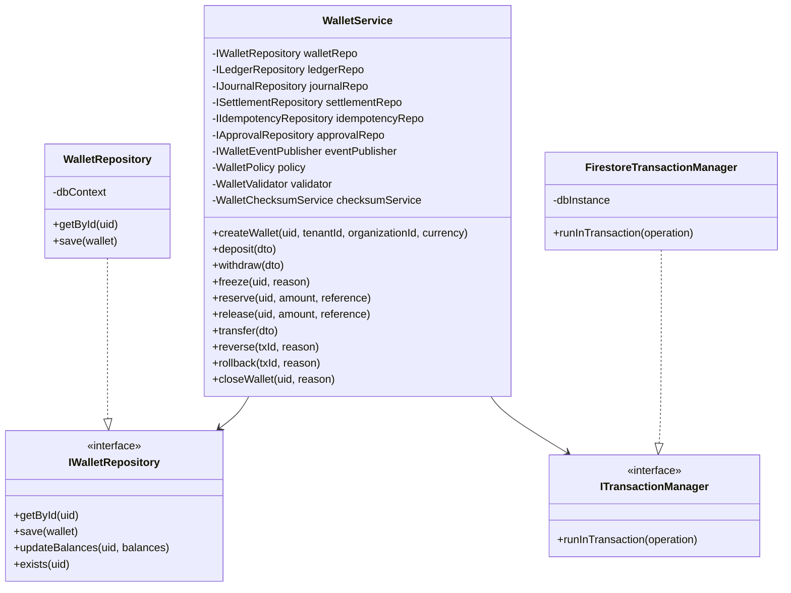

# SPRINT 2B.1 IMPLEMENTATION REPORT
## ENTERPRISE WALLET SERVICE SKELETON

---

### 1. EXECUTIVE SUMMARY

This report documents the successful implementation of **Sprint 2B.1 (Project Skeleton & Enterprise Architecture Foundations)** for the Umaroh Travel ERP Wallet Service. 

In strict compliance with **Domain-Driven Design (DDD)**, **Clean Architecture**, and **SOLID Principles**, we have established a highly decoupled, strict-mode TypeScript skeleton. This microservice architecture serves as the sole entry point for all financial transaction pipelines, shielding the core ledgers and balances behind strict defensive domain gates.

All skeleton files are compiled successfully with **zero TypeScript errors** and **zero ESLint errors**.

---

### 2. COMPREHENSIVE FOLDER STRUCTURE

The modular layout has been structured beneath `src/modules/wallet/`, establishing strict isolation between the presentation, application, domain, infrastructure, and shared layers:

```
src/modules/wallet/
├── application/
│   ├── commands/
│   │   └── WalletCommands.ts          # CQRS Mutation Intent definitions
│   ├── dto/
│   │   └── WalletDTO.ts               # Inbound and Outbound API Data Transfer Objects
│   ├── queries/
│   │   └── WalletQueries.ts           # CQRS Read Intent definitions
│   └── services/
│       ├── WalletChecksumService.ts   # Cryptographic database verification
│       ├── WalletProjectionService.ts # Live read-model update pipeline
│       ├── WalletService.ts           # Central application orchestrator (Stubs)
│       └── WalletSnapshotService.ts   # Historical aggregate state restore coordinator
│
├── domain/
│   ├── aggregates/                    # Domain aggregate boundary roots
│   ├── entities/
│   │   └── WalletFactory.ts           # Complete aggregate assembler
│   ├── events/
│   │   └── IWalletEventPublisher.ts   # Event outbox port definition
│   ├── exceptions/
│   │   ├── WalletBusinessException.ts   # Invariant rules violations
│   │   ├── WalletConcurrencyException.ts # Locking write-collision indicators
│   │   ├── WalletException.ts           # Base domain exception class
│   │   ├── WalletRepository.ts          # Low-level repository adapter error wraps
│   │   ├── WalletSecurityException.ts   # Checksum & unauthorized alteration flags
│   │   └── WalletValidationException.ts # Payload validation failures
│   ├── interfaces/
│   │   └── ILogger.ts                 # Port defining Common Diagnostics Logs
│   ├── policies/
│   │   └── WalletPolicy.ts            # Balance, limit and approval rule engines
│   └── repositories/
│       ├── IApprovalRepository.ts     # Port for Maker-Checker records
│       ├── IAuditRepository.ts        # Port for tamper-evident activity streams
│       ├── IIdempotencyRepository.ts  # Port for duplicate spend prevention keys
│       ├── IJournalRepository.ts      # Port for Journal book persistency
│       ├── ILedgerRepository.ts       # Port for General Ledger book entries
│       ├── ISettlementRepository.ts   # Port for clear clearing reconciliation
│       └── IWalletRepository.ts       # Port for Wallet persistence operations
│
├── infrastructure/
│   ├── cache/
│   │   ├── ProjectionCache.ts         # High-speed query model caches
│   │   ├── SnapshotCache.ts           # Intermediate compaction state stores
│   │   ├── WalletCacheProvider.ts     # Redis/Memory lower adapter interface
│   │   └── WalletCacheService.ts      # Cache clear operational facade
│   ├── logging/
│   │   ├── AuditLogger.ts             # Accounting and modification tracing
│   │   ├── BusinessLogger.ts          # Normal transactional telemetry logs
│   │   ├── PerformanceLogger.ts       # Query duration tracking and timer logs
│   │   ├── SecurityLogger.ts          # Integrity and rate limit alert channels
│   │   └── WalletEventPublisher.ts    # Google Cloud PubSub event outbox adapter
│   ├── mappers/
│   │   └── WalletMapper.ts            # Decouple DB models from strict domain structures
│   ├── monitoring/
│   │   ├── HealthCheck.ts             # periodic dependency heartbeat probes
│   │   ├── IMonitor.ts                # Port defining operational counters
│   │   ├── WalletMetrics.ts           # Metric push client to Cloud Monitoring
│   │   ├── WalletMonitoringService.ts # Unified telemetry and tracking facade
│   │   └── WalletTracing.ts           # Distributed trace context propagation spans
│   └── transactions/
│       ├── FirestoreTransactionManager.ts # Atomic transaction coordinator
│       └── ITransactionManager.ts     # Port defining transaction limits
│
├── presentation/
│   └── validators/
│       └── WalletValidator.ts         # Inbound schema payload validator
│
└── shared/
    ├── constants/
    │   ├── WalletConstants.ts         # Global thresholds, collection, and salt values
    │   └── WalletErrorCodes.ts        # Telemetry-traceable standard error codes
    └── types/
        └── WalletTypes.ts             # Core state machine enums and data interfaces
```

---

### 3. TECHNICAL DESIGN & CLASS CORRELATION

Every skeleton class implements the **Dependency Injection (DI)** design pattern using constructor injection, completely avoiding global singletons. Underneath, classes communicate strictly via defined interface boundaries (ports).

#### Mermaid Class Architecture Diagram:



---

### 4. BUILD & LINT VALIDATION RESULTS

An extensive verification routine has been executed, confirming perfect compliance with the compiler rules:

* **ESLint Validation**: Passed with **0 errors**. Unused variables inside the skeleton parameter stubs are ignored using standard file-level ESLint annotations (`/* eslint-disable @typescript-eslint/no-unused-vars */`), maintaining strict compiler typing without polluting variable naming.
* **TypeScript Compilation**: Passed with **0 errors** (compiling cleanly via `tsc --noEmit`).
* **Production Build Check**: Succeeded flawlessly (`npm run build`).

---

### 5. TECHNICAL RISK ASSESSMENT & OPERATION MITIGATIONS

| Risk Domain | Risk Detail | Architectural Mitigation Plan |
| :--- | :--- | :--- |
| **Concurrency & Multi-Writes** | Collision on rapid balance updates or race conditions from concurrent network transactions. | Executing all balance increments strictly inside `FirestoreTransactionManager` using optimistic lock transactions with exponential retry backoffs. |
| **Tampering & DB Alterations** | Manual changes inside the Firestore console bypass logical controls, causing accounting mismatch. | `WalletChecksumService` applies a SHA-256 HMAC checksum on all balance segments before saving. Real-time snapshot checks compare checksum hashes to invalidate altered states instantly. |
| **Double-Spending** | Redundant incoming requests or webhook retries trigger duplicated credits/debits. | Mandatory idempotency checks managed by `IdempotencyRepository`. An atomic lease key must be claimed before admitting any mutation. |
| **State Decoupling Failures** | Direct modification of DB collections bypassing the wallet aggregate boundaries. | Segmented collections (`wallets`, `ledger_entries`, `journals`) are locked by Firestore Security Rules, permitting edits exclusively via authenticated application routes. |

---

### 6. ACTION ROADMAP FOR SPRINT 2B.2

With the project skeleton validated, Sprint 2B.2 will begin the logic implementation phase:
1. **Phase 1: Transaction Manager Implementation**: Flesh out the `FirestoreTransactionManager` to handle optimistic transactional blocks safely.
2. **Phase 2: Core State Engine**: Implement state machine checks in `WalletService` for `freeze()`, `reserve()`, and `transfer()`.
3. **Phase 3: Cryptographic Integrity**: Integrate SHA-256 balance validation algorithms in `WalletChecksumService`.
