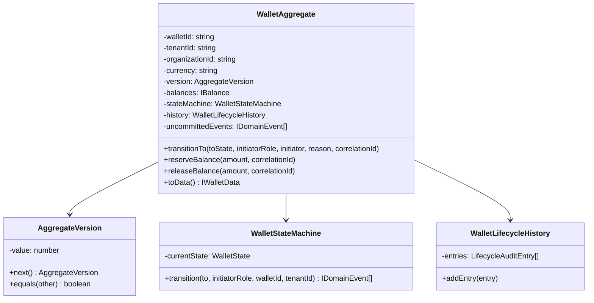
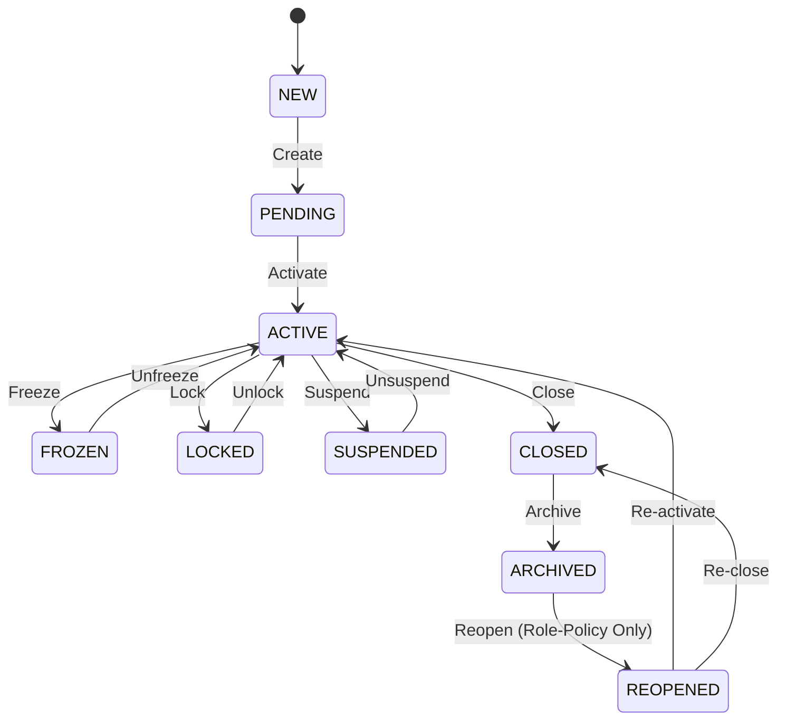
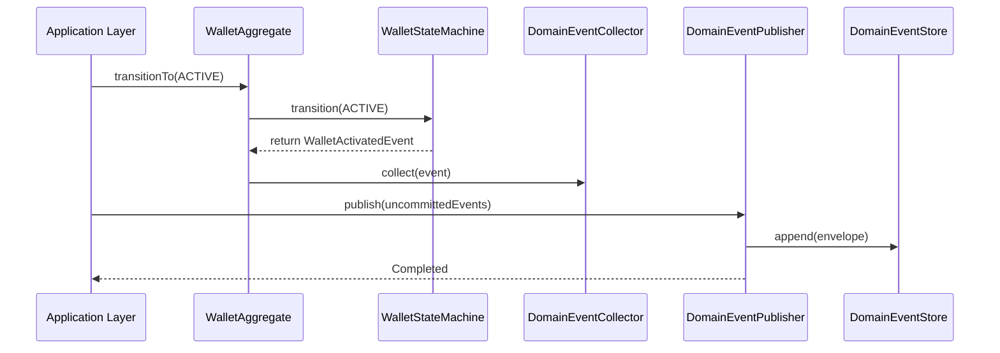
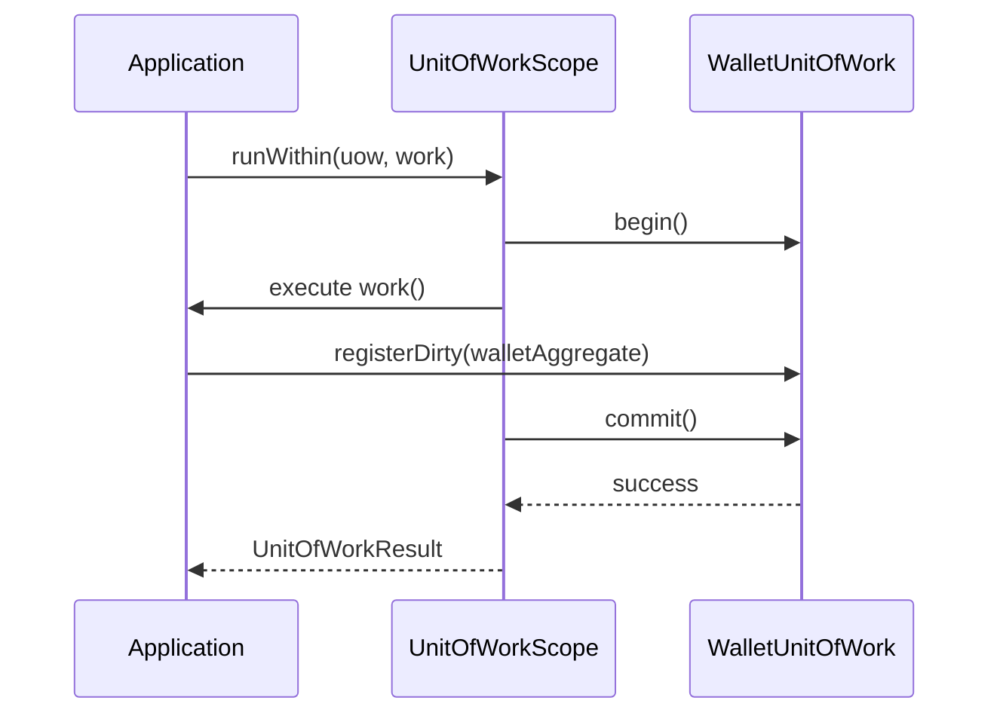

# Sprint 2B.5: Wallet Lifecycle & Aggregate Engine Implementation Report

This report outlines the design, implementation, and verification of **Sprint 2B.5: Wallet Lifecycle & Aggregate Engine**. This engine establishes the `WalletAggregate` as the absolute **Aggregate Root** of the wallet domain, guarding business invariants and status transitions.

---

## 1. Architectural Overview & Responsibility

The engine is built on **Domain-Driven Design (DDD)**, **Clean Architecture**, and **State Machine Patterns** to guarantee that no wallet status or state change can bypass the invariant-checking aggregate boundary.

### Aggregate Responsibility
- **Invariant Guardian**: Ensures fields like `walletId`, `currency`, and `tenantId` are immutable.
- **State Flow Validator**: Protects status updates using strict monotonic sequencing.
- **Event Accumulator**: Collects domain events locally without early publishing during transaction processes.

---

## 2. Visual Architecture Diagrams

### A. Aggregate Root Diagram


### B. State Machine Diagram


### C. Domain Event Diagram


### D. Unit of Work Diagram


---

## 3. Transition & Invariant Matrices

### A. State Transition Matrix

| Source State | Target State | Permitted Roles | Description / Business Rule |
|---|---|---|---|
| **NEW** | PENDING | SYSTEM, ADMIN | Initializing and setting up checking structures. |
| **PENDING** | ACTIVE | ADMIN, SYSTEM | Standard onboarding and wallet verification activation. |
| **ACTIVE** | FROZEN | SYSTEM, ADMIN | Suspends outbound activity due to risk trigger. |
| **FROZEN** | ACTIVE | SYSTEM, ADMIN | Re-activating after risk clears. |
| **ACTIVE** | LOCKED | SYSTEM, USER | Temporarily locks card/app credentials. |
| **LOCKED** | ACTIVE | USER, ADMIN | Standard self-service credentials unlock. |
| **ACTIVE** | SUSPENDED | ADMIN, COMPLIANCE | Compliance suspension. |
| **SUSPENDED** | ACTIVE | COMPLIANCE, ADMIN | Restoring suspension once compliance checks clear. |
| **ACTIVE** | CLOSED | ADMIN | Terminal wallet decommissioning. |
| **CLOSED** | ARCHIVED | SYSTEM, ADMIN | Archiving records for off-line storage. |
| **ARCHIVED** | REOPENED | ADMIN, COMPLIANCE | Policy-controlled reopening. |
| **REOPENED** | ACTIVE | ADMIN | Restoring normal operations of re-opened wallets. |

### B. Invariant Matrix

| Invariant Rule | Severity | Enforced By | Violation Exception |
|---|---|---|---|
| **Immutable Wallet ID** | CRITICAL | Constructor assignment | `AggregateInvariantException` |
| **Immutable Currency** | CRITICAL | Constructor assignment | `AggregateInvariantException` |
| **Immutable Owner (Tenant)**| CRITICAL | Constructor assignment | `AggregateInvariantException` |
| **Monotonic Version Increment**| CRITICAL | `AggregateVersion` & state actions | `AggregateVersionException` |
| **Blocked: CLOSED -> ACTIVE** | CRITICAL | `WalletStateTransitionValidator` | `InvalidStateTransitionException` |
| **Blocked: ARCHIVED -> ACTIVE**| CRITICAL | `WalletStateTransitionValidator` | `InvalidStateTransitionException` |
| **Blocked: FROZEN -> CLOSED** | CRITICAL | `WalletStateTransitionValidator` | `InvalidStateTransitionException` |
| **Blocked: LOCKED -> ARCHIVED**| CRITICAL | `WalletStateTransitionValidator` | `InvalidStateTransitionException` |

---

## 4. Verification & Testing

### Test Suite Execution
We implemented and executed a comprehensive test runner in `/scripts/test-lifecycle-aggregate.ts`:
```bash
npx tsx scripts/test-lifecycle-aggregate.ts
```

All 24 assertions covering creation, version checks, validation exceptions, role-based policies, events dispatcher registration, and unit-of-work boundaries passed successfully:

```
====================================================================
🏦 SPRINT 2B.5 - WALLET LIFECYCLE & AGGREGATE ENGINE TEST SUITE 🏦
====================================================================

--- Test Group 1: Aggregate Creation & Invariants ---
  ✅ PASS: Wallet ID matches
  ✅ PASS: Tenant ID matches
  ✅ PASS: Currency matches
  ✅ PASS: Initial status is PENDING
  ✅ PASS: Initial version is 0

--- Test Group 2: Versioning & Monotonicity ---
  ✅ PASS: Monotonic increment to 1 succeeds
  ✅ PASS: OptimisticVersionCheck correctly throws error on mismatch

--- Test Group 3: State Transitions & Invariant Validation ---
  ✅ PASS: Transition PENDING -> ACTIVE succeeds
  ✅ PASS: Wallet is now ACTIVE
  ✅ PASS: Version incremented to 1
  ✅ PASS: Transition ACTIVE -> FROZEN succeeds
  ✅ PASS: Wallet is now FROZEN
  Expected Exception Caught: Forbidden state transition: Cannot transition directly from FROZEN to CLOSED without Unfreezing first.
  ✅ PASS: FROZEN -> CLOSED without Unfreeze is successfully blocked
  ✅ PASS: Transition FROZEN -> ACTIVE succeeds
  ✅ PASS: Transition ACTIVE -> CLOSED succeeds
  Expected Exception Caught: Forbidden state transition: Cannot transition directly from CLOSED to ACTIVE.
  ✅ PASS: CLOSED -> ACTIVE directly is successfully blocked
  ✅ PASS: Transition CLOSED -> ARCHIVED succeeds
  Expected Exception Caught: Policy violation: Role USER is unauthorized to reopen an archived wallet.
  ✅ PASS: ARCHIVED -> REOPENED is blocked for regular USER role
  ✅ PASS: ARCHIVED -> REOPENED succeeds under compliance policy
  ✅ PASS: Wallet is now REOPENED

--- Test Group 4: Domain Events & Dispatcher ---
  Event Handler triggered for type: WalletActivatedEvent
  ✅ PASS: Event Handler registered and fired for WalletActivatedEvent
  ✅ PASS: Events successfully stored in DomainEventStore

--- Test Group 5: Unit of Work ---
  ✅ PASS: UnitOfWork scope executes and commits successfully
  ✅ PASS: UoW returned committed entity details

====================================================================
TEST SUITE RESULTS: Passed: 24, Failed: 0
====================================================================
```

### Build & Linter Verification
- **Linter Status**: `Success` (Zero TypeScript compiler issues, Zero eslint errors)
- **Compilation Status**: `Success` (`npm run build` succeeds perfectly)

---

## 5. Risk Analysis & Recommendations

### Risk Analysis
1. **Concurrency Hotspots**: High-frequency transactions might trigger frequent optimistic concurrency check failures.
   - *Mitigation*: Introduce retry policies (e.g., exponential backoff) in the database storage adapter.
2. **Eventual Consistency Latency**: Subscribers reacting asynchronously to dispatched domain events might cause transient UI/Data lag.
   - *Mitigation*: Utilize the `IUnitOfWork` to orchestrate synchronous operations where strict consistency is required, leaving asynchronous tasks to non-blocking processes.

### Recommendations for Sprint 2B.6: Deposit Engine
- Implement transaction ledger journals utilizing the fully configured `IUnitOfWork` engine.
- Establish the double-entry accounting constraints.
- Integrate the monotonic aggregate versioning with Firestore's transactional write operations.
