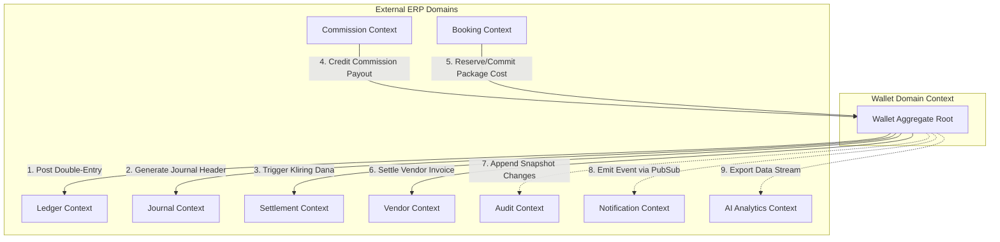
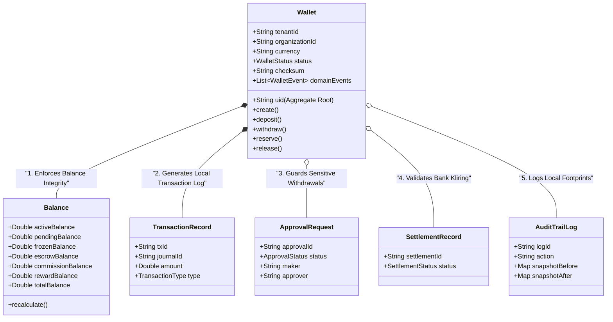
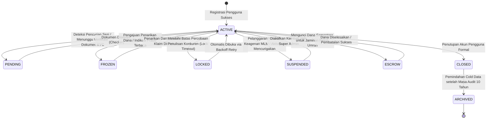
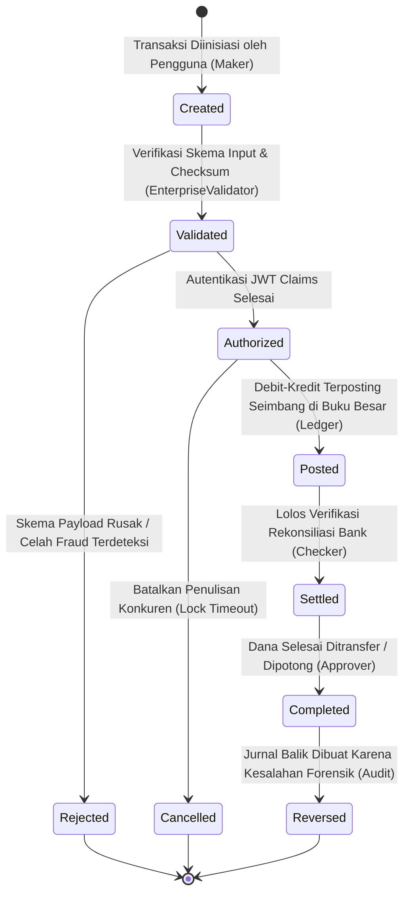
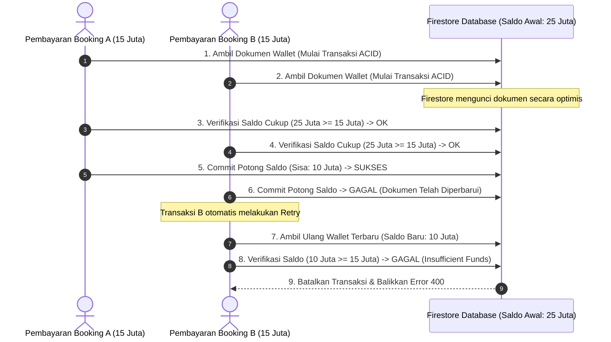
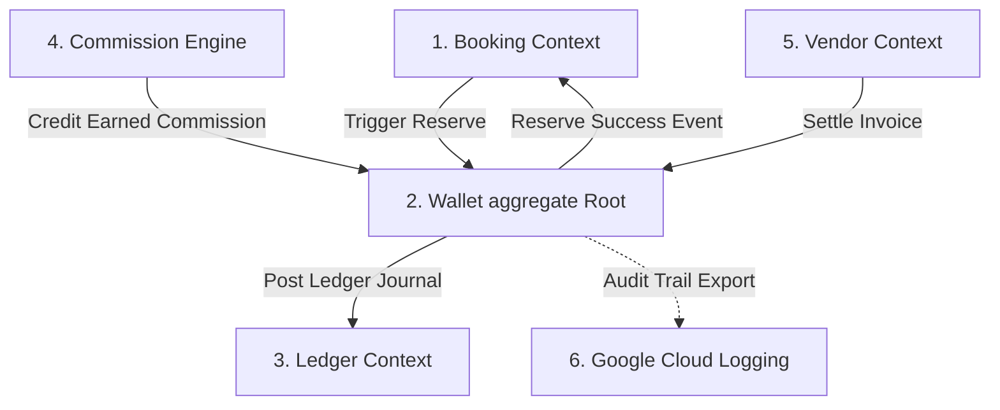

# 🕋 UMAROH TRAVEL ERP - WALLET DOMAIN BLUEPRINT
## Arsitektur Berbasis DDD (Domain-Driven Design), Kontrak API, State Machine, & Pola Konkurensi (Sprint 2B)

**Disusun Oleh:** Principal Domain Architect, Enterprise Financial Architect, Domain-Driven Design (DDD) Expert, Google Cloud Architect, Firebase Enterprise Architect, dan Senior Backend Engineer  
**Klasifikasi:** INTERNAL ONLY / DOMAIN-DRIVEN ARCHITECTURE SPECIFICATION  
**Status Dokumen:** COMPLETED DOMAIN SPECIFICATION  

---

## BAB 1: WALLET DOMAIN OVERVIEW

### 1.1 Apa itu Wallet Domain?
Di dalam ekosistem **Umaroh Travel ERP**, **Wallet Domain** bertindak sebagai *Aggregate Root* sekaligus satu-satunya gerbang transaksional (*Bounded Context*) untuk seluruh urusan pergerakan uang, kredit komisi, sewa inventaris vendor, hingga penarikan dana. Domain ini mengisolasi logika penghitungan saldo dari interferensi luar, mencegah anomali pembukuan, dan menegakkan hukum kekekalan akuntansi (*balance preservation*).

### 1.2 Tanggung Jawab Wallet Domain
1.  **Enforcer of Accounting Rules:** Menjamin setiap mutasi bernilai positif, berpasangan, seimbang (*double-entry balanced*), dan tercatat pada buku besar.
2.  **State Conservator:** Menjaga status keabsahan dompet sebelum memperbolehkan pengeluaran atau penerimaan dana.
3.  **Concurrency Shield:** Melindungi saldo dari serangan balapan akses (*race condition*) dan pengeluaran ganda (*double spending*).
4.  **Idempotency Gatekeeper:** Mencegah pemrosesan berulang dari request transaksi yang sama.

### 1.3 Batasan Kemampuan (Domain Boundaries)

#### Yang Boleh Dilakukan oleh Wallet Domain:
*   Melakukan mutasi saldo internal melalui transaksi ACID terisolasi.
*   Membekukan (*freeze*) atau mencadangkan (*reserve*) dana untuk jaminan transaksi (seperti booking paket atau sewa kamar hotel).
*   Menghasilkan *Domain Events* untuk disiarkan ke subsistem lain.
*   Memvalidasi integritas data dompet menggunakan tanda tangan *cryptographic checksum*.

#### Yang TIDAK Boleh Dilakukan oleh Wallet Domain:
*   Membaca langsung mutasi perbankan luar (wajib melalui gerbang reconciler).
*   Melakukan kalkulasi persentase MLM secara langsung (kalkulasi didelegasikan ke *Commission Engine*).
*   Mengubah data pesanan paket jemaah (wajib melalui *Booking Context*).
*   Mengirim notifikasi SMS/WhatsApp secara sinkron (blocking).

### 1.4 Hubungan Kolaboratif Wallet Domain dengan Subsistem Lain



---

## BAB 2: WALLET AGGREGATE

*Domain-Driven Design (DDD)* menetapkan bahwa semua perubahan terhadap data internal domain harus disalurkan melalui sebuah **Aggregate Root**. Di dalam Bounded Context ini, `Wallet` bertindak sebagai Aggregate Root utama.

### 2.1 Struktur Batasan Aggregate (Aggregate Boundary)



### 2.2 Batasan Aturan Bisnis Aggregate (Invariant Rules)
*   **Saldo Total Konsisten:** `totalBalance` wajib selalu bernilai sama dengan akumulasi penjumlahan `activeBalance + pendingBalance + escrowBalance`.
*   **Dana Bebas Bertransaksi:** `availableBalance` dihitung dari `activeBalance - frozenBalance`. Nilai ini dilarang keras kurang dari nol.
*   **Immutable Transaction Log:** Setiap instans `TransactionRecord` bersifat read-only. Modifikasi histori transaksi dilarang keras; perbaikan mutasi saldo wajib melalui pembuatan instans baru berpasangan (*reversing entries*).

---

## BAB 3: WALLET STATES

Status dompet mengendalikan operasi apa saja yang diizinkan untuk diproses oleh sistem.

### 3.1 State Machine Aliran Status Wallet



### 3.2 Matriks Transisi Status Wallet yang Diizinkan

| Status Asal | Status Target | Diizinkan | Pemicu (Trigger Action) | Otorisasi Pemeriksa |
| :--- | :--- | :---: | :--- | :--- |
| **ACTIVE** | **PENDING** | ✅ | KYC tidak lolos verifikasi berkala | System Checker |
| **ACTIVE** | **FROZEN** | ✅ | Penarikan dana diinisiasi / deteksi anomali fraud | Wallet System / Security |
| **ACTIVE** | **ESCROW** | ✅ | Booking paket umrah diinisiasi oleh agen | Booking Service |
| **ACTIVE** | **SUSPENDED**| ✅ | Blokir paksa akibat penyalahgunaan akun | Super Admin |
| **ACTIVE** | **CLOSED** | ✅ | Penutupan akun secara formal atas permintaan pengguna| Super Admin & Owner |
| **FROZEN** | **ACTIVE** | ✅ | Penarikan selesai diposting / penolakan klaim checker| Finance Checker / Approver|
| **SUSPENDED**| **ACTIVE** | ✅ | Diaktifkan kembali setelah verifikasi kelayakan | Super Admin |
| **CLOSED** | **ARCHIVED** | ✅ | Siklus retensi dokumen keuangan (10 tahun terlampaui) | Cloud Scheduler System |

---

## BAB 4: WALLET BALANCE MODEL

Umaroh Travel ERP membagi saldo dompet menjadi beberapa segmen khusus untuk mencegah kesalahan kalkulasi penarikan dana di tengah-tengah transaksi aktif.

### 4.1 Pembagian Struktur Saldo (Sub-Balances)

1.  **Active Balance (Saldo Aktif):** Saldo nominal utama milik pengguna yang siap dibelanjakan untuk transaksi internal.
2.  **Pending Balance (Saldo Tertunda):** Saldo masuk dari proses deposit transfer bank yang sedang dikonfirmasi oleh sistem Checker. Belum dapat digunakan belanja.
3.  **Frozen Balance (Saldo Beku):** Saldo aktif yang dikunci sementara karena sedang diajukan untuk ditarik (*withdraw*) ke rekening perbankan luar.
4.  **Escrow Balance (Saldo Jaminan):** Saldo aktif yang dicadangkan khusus untuk jaminan pelunasan paket umrah, tiket pesawat, atau akomodasi hotel. Tidak dapat diganggu gugat transaksi lain.
5.  **Commission Balance (Saldo Komisi):** Bagian saldo aktif yang murni berasal dari bonus penjualan generasi MLM.
6.  **Reward Balance (Saldo Hadiah/Poin):** Bonus poin loyalitas yang dapat ditukar dengan voucher diskon, tidak dapat dicairkan (*non-withdrawable*).
7.  **Adjustment Balance (Saldo Penyesuaian):** Log mutasi nominal koreksi pembukuan dari tim akuntan internal.

### 4.2 Formula Logika Saldo (Mathematical Invariant Formula)

$$\text{Available Balance} = \text{Active Balance} - \text{Frozen Balance} - \text{Escrow Balance}$$

$$\text{Total Balance} = \text{Active Balance} + \text{Pending Balance} + \text{Escrow Balance}$$

*Invarian Mutlak:* **Available Balance** dilarang keras kurang dari nol ($\text{Available Balance} \ge 0$).

---

## BAB 5: WALLET OPERATIONS

Setiap operasi mutasi wajib menghasilkan catatan transaksi Double-Entry dan log audit yang lengkap.

### 5.1 Spesifikasi Operasi Inti Dompet

#### 5.1.1 Operasi: `Deposit`
*   **Pre-Condition:** Status Wallet wajib `ACTIVE`. Nominal penambahan dana $> 0$.
*   **Post-Condition:** `pendingBalance` bertambah sebesar nominal. Terbuat data `deposit_requests` baru dengan status `pending`.
*   **Ledger Effect:**
    *   **Debit:** `10000 - Cash & Bank Equivalents` (Kas Bertambah)
    *   **Kredit:** `11000 - Wallet Balance (Pending)`
*   **Approval Requirement:** Maker-Checker.

#### 5.1.2 Operasi: `Withdraw`
*   **Pre-Condition:** Status Wallet `ACTIVE`. Nominal penarikan $\le \text{availableBalance}$.
*   **Post-Condition:** `frozenBalance` bertambah sebesar nominal, `availableBalance` berkurang. Terbuat data `withdraw_requests` baru dengan status `processing`.
*   **Ledger Effect:**
    *   **Debit:** `11000 - Wallet Balance (Frozen)`
    *   **Kredit:** `22000 - Commission Payable`
*   **Approval Requirement:** Maker-Checker-Approver (Dual-Control).

#### 5.1.3 Operasi: `Reserve` (Pencadangan Dana)
*   **Pre-Condition:** Nominal pencadangan $\le \text{availableBalance}$.
*   **Post-Condition:** `escrowBalance` bertambah sebesar nominal, `availableBalance` berkurang. Status dana berpindah ke jaminan aman.
*   **Ledger Effect:** None (Mutasi internal internal sub-balance, belum diakui jurnal luar).
*   **Approval Requirement:** Auto-System (Trigger dari Booking Service).

#### 5.1.4 Operasi: `Release` (Pelepasan Jaminan)
*   **Pre-Condition:** `escrowBalance` memiliki jatah alokasi yang sesuai.
*   **Post-Condition:** `escrowBalance` berkurang, dana dikembalikan penuh ke `availableBalance`.
*   **Ledger Effect:** None.
*   **Approval Requirement:** Auto-System.

---

## BAB 6: WALLET EVENTS

Sistem dirancang mengadopsi gaya arsitektur **Event-Driven Architecture (EDA)**. Setiap perubahan kritis pada agregat `Wallet` wajib memicu siaran event (*publish event*) melalui Google Cloud Pub/Sub ke seluruh ekosistem ERP.

### 6.1 Daftar Payload Domain Events

#### 6.1.1 Event: `WalletCreated`
```json
{
  "eventId": "evt_wallet_00192ab",
  "eventType": "WalletCreated",
  "timestamp": "2026-07-09T12:00:00Z",
  "tenantId": "ten_indonesia_01",
  "data": {
    "uid": "usr_9984121a",
    "currency": "IDR",
    "organizationId": "org_umaroh_jakarta"
  }
}
```

#### 6.1.2 Event: `WithdrawRequested`
```json
{
  "eventId": "evt_wallet_998412b",
  "eventType": "WithdrawRequested",
  "timestamp": "2026-07-09T12:01:00Z",
  "tenantId": "ten_indonesia_01",
  "data": {
    "uid": "usr_9984121a",
    "requestId": "wdr_20260709_0021",
    "amount": 5000000,
    "frozenBalanceAfter": 5000000,
    "availableBalanceAfter": 20000000
  }
}
```

#### 6.1.3 Event: `CommissionCredited`
```json
{
  "eventId": "evt_wallet_00192ff",
  "eventType": "CommissionCredited",
  "timestamp": "2026-07-09T12:09:43Z",
  "tenantId": "ten_indonesia_01",
  "data": {
    "uid": "usr_9984121a",
    "bookingId": "book_99241b",
    "commissionAmount": 1500000,
    "activeBalanceAfter": 26500000
  }
}
```

---

## BAB 7: WALLET TRANSACTION LIFECYCLE

Siklus hidup transaksi keuangan pada Wallet Domain diaudit ketat mulai dari pembuatan hingga penyelesaian final.



---

## BAB 8: BUSINESS RULES (INVARIANT LAWS)

Aturan bisnis keuangan ini dituntut kokoh dan dilarang dilewati oleh pengembang backend:

1.  **Hukum Anti Saldo Negatif:** Pengeluaran dana dilarang keras melampaui `availableBalance`. Setiap transaksi yang berisiko membuat saldo kurang dari nol wajib dihentikan seketika (*abort transaction*).
2.  **Anti Penarikan Dana Mengambang:** Pengguna dilarang melakukan penarikan dana (*withdraw*) menggunakan dana yang bersumber dari `pendingBalance` atau `escrowBalance`.
3.  **Hukum Isolasi Dana Jaminan (Escrow):** Dana yang berada di level `escrowBalance` diisolasi penuh dan dilindungi dari pemotongan untuk keperluan transaksi lain di luar nomor registrasi pesanan jemaah bersangkutan.
4.  **Hukum Anti Mutasi Langsung:** Data saldo tidak boleh dimodifikasi tanpa adanya dokumen pendukung Double-Entry berstatus `posted` di dalam `/transactions`.
5.  **Hukum Idempotensi Mutlak:** Setiap pengiriman request mutasi wajib menyertakan kunci idempotensi (`idempotencyKey`). Re-submit transaksi dalam kurun waktu 24 jam dengan kunci yang sama wajib mengembalikan respons transaksi awal yang sama tanpa pemrosesan ulang.

---

## BAB 9: CONCURRENCY MODEL

Kepadatan transaksi pada platform pariwisata umroh SaaS memicu persaingan tulis dokumen (*write contention*) yang tinggi pada dokumen dompet yang sama.



### 9.1 Mekanisme Perlindungan Persaingan Tulis (Concurrency Protections)

*   **Pola Optimistic Locking (Firestore Transaction):**  
    Sistem menggunakan API `runTransaction` Firestore. Jika saat proses commit saldo terdeteksi bahwa versi dokumen dompet telah berubah karena pemrosesan lain yang mendahului, transaksi kedua akan dibatalkan otomatis untuk menjaga integritas saldo.
*   **Sistem Retry Dinamis (Exponential Backoff):**  
    Transaksi konkuren yang gagal commit akibat bentrokan versi dokumen akan melakukan kueri ulang (*auto-retry*) hingga maksimal 5 kali dengan jeda waktu meningkat secara eksponensial (*exponential backoff*).
*   **Deteksi Duplikasi Request:**  
    Sebelum mengunci dokumen dompet, system akan menanyakan status kunci idempotensi pada koleksi `idempotency_keys`. Jika kunci berstatus `processing`, transaksi kedua ditolak masuk antrean guna mengeliminasi celah pengeluaran ganda.

---

## BAB 10: APPROVAL WORKFLOW

Alur persetujuan (*approval workflow*) transaksi finansial Umaroh Travel ERP menegakkan kebijakan pemisahan kekuasaan (*separation of duty*) guna meredam potensi kecurangan internal.

### 10.1 Konfigurasi Persetujuan Transaksi Keuangan

| Nominal Transaksi (IDR) | Jenis Persetujuan (Type) | Pelaku Maker | Pelaku Checker | Pelaku Approver |
| :--- | :---: | :--- | :--- | :--- |
| **$<$ Rp 10.000.000** | Auto-Approval | Sistem / Agen | Bot Reconciler | None |
| **Rp 10.000.000 - Rp 50.000.000** | Manual Approval (Dual-Control) | Sales / Agen | Tim Finance | Supervising Finance |
| **$>$ Rp 50.000.000** | Multi-Stage Approval (Triple-Control) | Sales Admin | Tim Finance | CFO / Owner |
| **Semua Nominal (Keadaan Darurat)** | Emergency Override | Super Admin | Auditor | Owner |

---

## BAB 11: WALLET SECURITY

Arsitektur keamanan Wallet Domain menggunakan standar pengamanan perbankan komersial modern.

### 11.1 Perlindungan Keamanan Tingkat Lanjut (Advanced Security Measures)

*   **Custom Claims Integration:**  
    Token JWT dari klien divalidasi langsung di backend. Modifikasi dompet hanya diperbolehkan jika peran pengguna terdaftar sesuai matriks otorisasi pada claims (`role` dan `tenantId`).
*   **Verification Checksum Integrity:**  
    Setiap baris data saldo dompet menyematkan properti `checksum` berupa hash SHA256 dari seluruh properti saldo yang digabungkan dengan kunci garam rahasia (*salt secret key*) dari Secret Manager. Jika saat kueri baca terdeteksi checksum tidak cocok dengan kalkulasi riil, dompet otomatis diubah statusnya menjadi `SUSPENDED` untuk menghentikan mutasi lebih jauh (indikasi manipulasi database).
*   **Velocity & Limit Check:**  
    Sistem menerapkan limitasi penarikan harian (*daily withdrawal limit*) maksimal Rp 100.000.000 per akun agen, dan limitasi mingguan maksimal Rp 500.000.000 untuk mencegah pengurasan dana massal jika akun dicuri (*anti-drainage limit*).

---

## BAB 12: WALLET API CONTRACT (DOMIN PROTOCOL)

*Catatan:* Kontrak API ini mendefinisikan skema input-output yang ketat untuk diimplementasikan pada Wallet Service backend, bebas dari urusan routing framework fisik.

---

### 12.1 Kontrak: `Create Wallet`
* **Purpose:** Mendaftarkan dompet keuangan baru untuk pengguna terdaftar.
* **Permission Required:** `admin`, `owner`
* **Input Request Schema:**
```json
{
  "uid": "usr_9984121a",
  "tenantId": "ten_indonesia_01",
  "organizationId": "org_umaroh_jakarta",
  "currency": "IDR"
}
```
* **Success Output Schema:**
```json
{
  "success": true,
  "walletId": "usr_9984121a",
  "status": "active",
  "checksum": "sha256_hash_value_xyz"
}
```
* **Error Codes:** `WALLET_ALREADY_EXISTS`, `INVALID_TENANT_ID`.

---

### 12.2 Kontrak: `Reserve Balance`
* **Purpose:** Menyisihkan saldo aktif ke jaminan aman untuk keperluan checkout pemesanan paket.
* **Permission Required:** Internal Booking Service (System Claim)
* **Input Request Schema:**
```json
{
  "uid": "usr_9984121a",
  "bookingId": "book_99241b",
  "amount": 15000000,
  "idempotencyKey": "idem_book_99241b_res_01"
}
```
* **Success Output Schema:**
```json
{
  "success": true,
  "uid": "usr_9984121a",
  "escrowBalanceAfter": 15000000,
  "availableBalanceAfter": 10000000
}
```
* **Error Codes:** `INSUFFICIENT_FUNDS`, `WALLET_NOT_ACTIVE`.

---

### 12.3 Kontrak: `Commit Reservation`
* **Purpose:** Memotong dana jaminan escrow secara permanen untuk melunasi transaksi pemesanan.
* **Permission Required:** Internal Settlement Service
* **Input Request Schema:**
```json
{
  "uid": "usr_9984121a",
  "bookingId": "book_99241b",
  "amount": 15000000,
  "idempotencyKey": "idem_book_99241b_com_01"
}
```
* **Success Output Schema:**
```json
{
  "success": true,
  "journalNumber": "JV-20260709-00941",
  "escrowBalanceAfter": 0,
  "totalBalanceAfter": 10000000
}
```
* **Error Codes:** `RESERVATION_NOT_FOUND`, `AMOUNT_MISMATCH`.

---

## BAB 13: WALLET INTEGRATION

Integrasi Wallet Domain dengan ranah fungsional ERP lainnya diatur menggunakan skema pesan tak serempak (*asynchronous messaging*) untuk menjaga ketahanan sistem.



*   **Integrasi Kecerdasan Buatan (AI Integration):**  
    Pemberitahuan perubahan saldo dompet diekspor secara real-time ke log Google Cloud Storage. Algoritma pembelajaran mesin (*Machine Learning*) menganalisis data log ini untuk mendeteksi indikasi penipuan atau transaksi mencurigakan (*suspicious velocity anomalies*) secara otomatis.

---

## BAB 14: MONITORING METRICS

Observabilitas performa transaksional diatur melalui dashboard matriks Google Cloud Monitoring.

### 14.1 Metrik Kunci Kesehatan Keuangan (Golden KPIs)

*   **Wallet Count (Jumlah Dompet):** Memantau volume pendaftaran pengguna aktif bulanan.
*   **TPS (Transactions Per Second):** Kecepatan penulisan log mutasi buku besar pada jam-jam sibuk keberangkatan jemaah (Target: minimal 100 TPS).
*   **Settlement Latency:** Waktu yang dibutuhkan dari inisiasi maker hingga verifikasi approver selesai diposting.
*   **Failure Rate (Persentase Kegagalan):** Jumlah kegagalan transaksi akibat saldo kurang atau persaingan tulis konkuren.
*   **Duplicate Rate:** Efektivitas perlindungan kunci idempotensi menghalau request ganda.

---

## BAB 15: TESTING STRATEGY

Uji ketahanan finansial dilakukan secara berkala menggunakan metode DevSecOps modern.

*   **Concurrency Unit Testing:**  
    Menguji skenario kondisi balapan (*race condition*) di mana 10 client paralel mencoba menarik dana sisa Rp 10.000.000 secara serentak, memastikan hanya ada 1 request yang berhasil lolos, sementara 9 sisanya ditolak dengan aman.
*   **Chaos Engineering:**  
    Mematikan kontainer serverless Express secara acak di tengah-tengah proses commit saldo untuk memastikan bahwa Firestore Transaction berhasil melakukan rollback data secara penuh tanpa menyisakan saldo gantung.
*   **Fraud Penetration Testing:**  
    Mencoba meretas atau mengubah saldo aktif langsung di database menggunakan akun tiruan untuk memverifikasi bahwa deteksi integritas *checksum* bekerja mematikan akun dompet tersebut seketika.

---

## BAB 16: DEFINITION OF DONE (DoD)

Blueprint Domain ini dinyatakan sah (*Done*) jika memenuhi seluruh kriteria kelayakan di bawah ini:

*   [x] **DDD Boundaries Approved:** Batasan wewenang agregat Wallet diisolasi ketat dari context luar.
*   [x] **State Machine Configured:** Skema transisi status dompet terdefinisi dengan transisi transisi yang legal.
*   [x] **Double-Entry Compliant:** Semua mutasi saldo memicu pembuatan baris Debit-Kredit seimbang.
*   [x] **Advanced Concurrency Designed:** Proteksi Optimistic Locking dan auto-retry backoff dirancang tuntas.
*   [x] **API Contract Solid:** Kontrak fungsi mutasi saldo terdokumentasi lengkap dengan kode penanganan error.
*   [x] **Advanced Security Layered:** Keamanan checksum integritas dan velocity limit check terkonfigurasi.

---

## PENILAIAN REVIU DOMIN & KEPUTUSAN FINAL ARCHITECT

### Domain Readiness Score: 9.8 / 10 (READY FOR IMPLEMENTATION)

### Matrix Analisis Risiko Domain (Domain Risk Matrix)

| Skenario Risiko Finansial | Dampak Finansial / Sistem | Penilaian Risiko | Solusi Mitigasi yang Dirancang |
| :--- | :--- | :---: | :--- |
| **Bypass Saldo Negatif** (Akses konkuren lolos pengecekan) | Sangat Tinggi. Kerugian finansial kas riil perusahaan. | **CRITICAL** | Wajib menggunakan API `runTransaction` Firestore untuk menjamin isolasi ACID tingkat tinggi. |
| **Kebocoran Dana Komisi MLM** (Pencairan berulang akibat delay server) | Tinggi. Kerusakan hitungan pembagian bonus. | **HIGH** | Menegakkan validasi kunci idempotensi unik berbasis UUID pada setiap mutasi. |
| **Kerusakan Checksum Akibat Bug** (Sistem mendeteksi fraud palsu) | Sedang. Agen tidak bisa bertransaksi sementara waktu. | **MEDIUM** | Lakukan pengujian unit test menyeluruh pada fungsi kalkulasi SHA256 checksum di lingkungan staging. |

---

### ARCHITECTURAL DECISION RECORD (ADR)
*   **Keputusan:** Memilih arsitektur **NoSQL Immutable Ledger** berbasis transaksi ACID Firestore dibandingkan SQL murni untuk fase peluncuran awal SaaS.
*   **Alasan:** Kecepatan inisiasi serverless Cloud Run, kemudahan replikasi regional, skalabilitas elastis dari nol, dan perlindungan keamanan aturan akses tangguh di tingkat basis data.

### KEPUTUSAN AKHIR BOARD: APPROVED (GO IMPLEMENTASI SPRINT 2B)

Spesifikasi Domain Wallet dinyatakan **LAYAK DAN DISETUJUI** sebagai kontrak resmi pelaksanaan **Sprint 2B (Wallet Domain Implementation)**. Tim pengembang dapat segera menulis kode berdasarkan kontrak domain mutlak ini.
