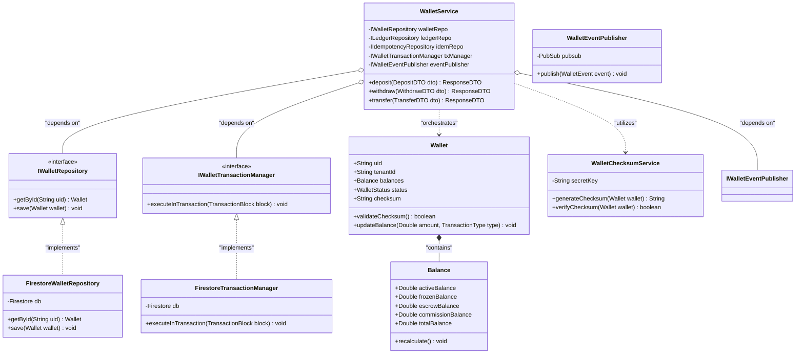
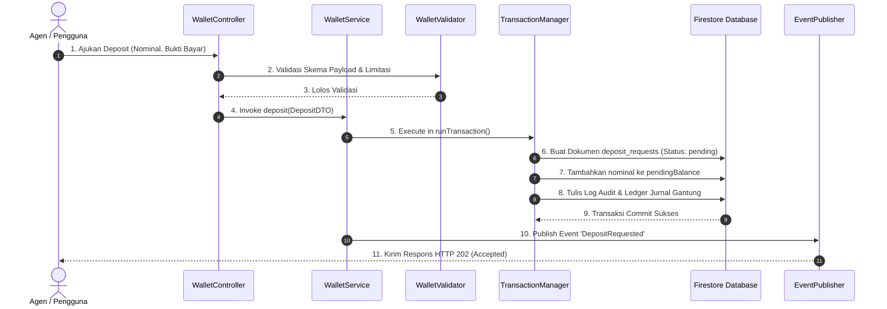
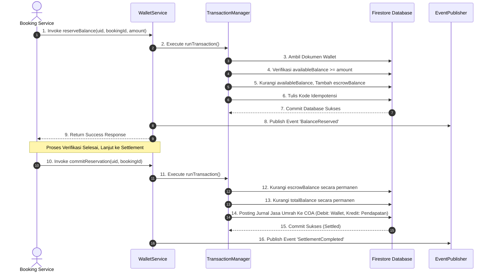
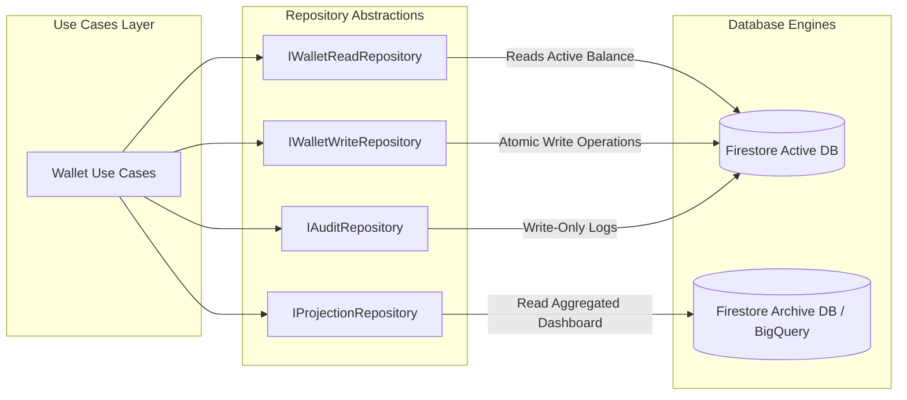

# 🕋 UMAROH TRAVEL ERP - WALLET SERVICE TECHNICAL DESIGN DOCUMENT (TDD)
## Spesifikasi Teknis Implementasi, Pola Arsitektur Bersih, Integrasi NoSQL, & Tata Kelola Transaksi (Sprint 2B)

**Disusun Oleh:** Technical Lead, Principal Backend Engineer, Google Cloud Architect, Firebase Enterprise Architect, Enterprise Software Engineer, Domain-Driven Design (DDD) Expert, dan DevSecOps Lead  
**Klasifikasi:** INTERNAL ONLY / TECHNICAL DESIGN SPECIFICATION  
**Status Dokumen:** APPROVED FOR SPRINT CONSTRUCT  

---

## DAFTAR ISI
1. [Technical Overview](#bab-1-technical-overview)
2. [Project Structure](#bab-2-project-structure)
3. [Class Diagram](#bab-3-class-diagram)
4. [Sequence Diagram](#bab-4-sequence-diagram)
5. [Transaction Manager](#bab-5-transaction-manager)
6. [Repository Pattern](#bab-6-repository-pattern)
7. [Validation Layer](#bab-7-validation-layer)
8. [Exception Strategy](#bab-8-exception-strategy)
9. [Logging Strategy](#bab-9-logging-strategy)
10. [Monitoring](#bab-10-monitoring)
11. [Caching Strategy](#bab-11-caching-strategy)
12. [Concurrency](#bab-12-concurrency)
13. [Security](#bab-13-security)
14. [Performance](#bab-14-performance)
15. [Testing Plan](#bab-15-testing-plan)
16. [Deployment Strategy](#bab-16-deployment-strategy)
17. [Definition of Done](#bab-17-definition-of-done)
18. [Output Akhir & Lampiran Teknis](#output-akhir--lampiran-teknis)

---

## BAB 1: TECHNICAL OVERVIEW

### 1.1 Tujuan Wallet Service
**Wallet Service** adalah modul orkestrasi transaksional pusat pada platform Umaroh Travel ERP yang bertanggung jawab mengelola seluruh mutasi nilai finansial, pembukuan ledger ganda (*double-entry bookkeeping*), pencadangan dana (*escrow*), pelunasan tiket/hotel vendor, dan pembagian komisi keagenan MLM secara aman dan akurat.

### 1.2 Batasan Layanan (Service Boundary)
*   **Logical Boundary:** Mengisolasi status dan logika mutasi saldo dompet dari campur tangan luar. Seluruh penulisan wajib disalurkan melalui antarmuka internal Wallet Service.
*   **Database Boundary:** Memanfaatkan Firebase Firestore secara eksklusif. Komunikasi langsung dari klien dibatasi oleh Firestore Security Rules (Read-Only). Operasi tulis mutlak milik Admin SDK di sisi backend.
*   **Network Boundary:** Beroperasi sebagai layanan mikro (*microservice*) di dalam container Google Cloud Run yang terlindungi oleh Google Cloud Armor dan Express API Gateway.

### 1.3 Ketergantungan Eksternal (Dependencies)
1.  **Google Secret Manager:** Penyimpanan aman Firebase Service Account credentials dan API Keys.
2.  **Firebase Authentication (Custom Claims):** Validasi identitas pengguna, peran (*role*), dan isolasi tenant (`tenantId`).
3.  **Google Cloud Pub/Sub:** Menyebarkan pesan asinkron (*domain events*) untuk dikonsumsi sistem eksternal.

### 1.4 Tanggung Jawab Layanan (Service Responsibility)
*   Menjamin atomisitas transaksi multi-dokumen (saldo dompet + mutasi + jurnal buku besar).
*   Mencegah pembelanjaan ganda (*double spending*) dan saldo negatif menggunakan teknik *Optimistic Locking*.
*   Menghitung, memvalidasi, dan memperbarui integritas *cryptographic checksum* dompet digital.

### 1.5 Diagram Ketergantungan (Dependency Diagram)

```mermaid
graph TD
    subgraph Client Space
        A[Client Browser / Mobile App]
    end

    subgraph API Gateway (Cloud Run)
        B[Express.js Router]
        C[Wallet Service Interface]
    end

    subgraph Core Domain Components
        D[Wallet Aggregate Root]
        E[Transaction Manager]
        F[Validation Layer]
    end

    subgraph Infrastructure Providers
        G[Firestore DB]
        H[Pub/Sub Broker]
        I[Secret Manager]
    end

    %% Flow connections
    A -->|1. HTTPS Request with JWT Bearer Token| B
    B -->|2. Route Delegation| C
    C -->|3. Invoke Domain Operations| D
    D -->|4. Enforce ACID Invariants| E
    E -->|5. Run Schema & Policy Audit| F
    E -->|6. Atomic Write| G
    E -->|7. Publish Domain Event| H
    D -.->|8. Pull Decryption Key| I
```

---

## BAB 2: PROJECT STRUCTURE

Arsitektur repositori menggunakan pola **Clean Architecture** yang dikombinasikan dengan prinsip taktis **Domain-Driven Design (DDD)** untuk memisahkan logika bisnis murni dari detail infrastruktur.

```
/src
│
├── application/                     # Application Layer (Orkestrasi Alur Kerja)
│   ├── usecases/                    # Use Case aplikasi (ProcessPayment, RequestWithdraw, dll.)
│   └── services/                    # Application services pendukung
│
├── domain/                          # Domain Layer (Logika Bisnis Murni - SOLID, No External Libs)
│   ├── entities/                    # Entitas inti domain (Wallet, Balance, TransactionRecord)
│   ├── factories/                   # Factory pembentuk aggregate (WalletFactory)
│   ├── policies/                    # Aturan/kebijakan bisnis (WalletPolicy)
│   ├── valueobjects/                # Nilai tetap (Currency, Checksum)
│   └── exceptions/                  # Domain specific exceptions (InsufficientBalanceException)
│
├── infrastructure/                  # Infrastructure Layer (Adapter luar & integrasi library)
│   ├── repositories/                # Implementasi repositori konkret (FirestoreWalletRepository)
│   ├── security/                    # Enkripsi & checksum (ChecksumService)
│   ├── persistence/                 # Inisialisasi Firebase Admin SDK & Firestore Connection
│   ├── messaging/                   # Handler Pub/Sub (EventPublisher)
│   └── monitoring/                  # Integrasi OpenTelemetry & Winston Logging
│
├── interfaces/                      # Interfaces Layer (Pintu masuk request luar)
│   ├── controllers/                 # Express Controllers (HTTP Endpoint Handlers)
│   ├── mappers/                     # Konversi entitas ke DTO dan sebaliknya (WalletMapper)
│   └── dto/                         # Data Transfer Objects (Request/Response schemas)
│
└── shared/                          # Shared Kernel (Utilitas lintas domain)
    ├── validators/                  # Validasi skema (Zod/Joi EnterpriseValidator)
    └── constants/                   # Nilai konstanta global (Error Codes, Statuses)
```

---

## BAB 3: CLASS DIAGRAM

Arsitektur kelas dirancang dengan kepatuhan penuh terhadap prinsip **Single Responsibility Principle (SRP)** dan **Dependency Inversion Principle (DIP)**.



---

## BAB 4: SEQUENCE DIAGRAMS

Diagram berikut mendeskripsikan interaksi antar-objek dalam orkestrasi mutasi transaksi finansial utama.

### 4.1 Aliran Transaksi: `Deposit` (Pengajuan s.d Selesai)



### 4.2 Aliran Transaksi: `Reserve` & `Settlement` (Checkout Paket)



---

## BAB 5: TRANSACTION MANAGER

Untuk menjamin konsistensi mutasi keuangan NoSQL, Wallet Service mengimplementasikan **Enterprise Transaction Manager** berbasis API `runTransaction` Firestore.

### 5.1 Mekanisme ACID & Manajemen Kegagalan

```
                        [ MULAI TRANSAKSI KEUANGAN ]
                                     │
                                     ▼
                      1. Ambil Dokumen (Read Lock)
                                     │
                                     ▼
                   2. Pengecekan Aturan Bisnis & Saldo
                    (Available >= Required? / Active?)
                                     │
                                     ├─────────────────────────┐
                                  [ YA ]                     [ TIDAK ]
                                     │                         │
                                     ▼                         ▼
                       3. Siapkan Operasi Tulis            Batalkan &
                         (Write Buffering)                  Rollback
                                     │                         │
                                     ▼                         │
                        4. Commit Tulis Database               │
                                     │                         │
              ┌──────────────────────┴──────────────────────┐  │
          [ SUKSES ]                                    [ BENTROK ]                     │
              │                                             │  │
              ▼                                             ▼  │
         Selesai &                                      Auto-Retry                     │
        Kirim Event                                  (Max 5x, Backoff)                 │
              │                                             │  │
              │                                             ▼  │
              │                                         Selesai /                      │
              │                                        Limit Exceed                    │
              │                                             │  │
              └──────────────────────┬──────────────────────┘  │
                                     │                         │
                                     ▼                         ▼
                                [ SELESAI ] <──────────────────┘
```

*   **Optimistic Locking:** Firestore melacak versi dokumen yang dibaca selama transaksi. Jika sebelum commit terdeteksi dokumen tersebut telah diperbarui oleh thread paralel lain, transaksi saat ini digagalkan seketika tanpa mengubah status data.
*   **Auto-Retry Backoff Policy:** Transaksi yang gagal akibat bentrokan versi dokumen (*contention*) otomatis diulang up-to 5 kali dengan jeda waktu eksponensial acak (*exponential backoff with jitter*) untuk meminimalkan bentrokan berulang.
*   **Deadlock Prevention:** Seluruh pembacaan dokumen wajib diletakkan di bagian awal blok transaksi sebelum melakukan operasi penulisan (*reads must precede writes*). Aturan ini mutlak untuk mencegah terjadinya kebuntuan akses dokumen paralel (*deadlock*).

---

## BAB 6: REPOSITORY PATTERN

Kami memisahkan kekhawatiran operasional database dengan menerapkan **Command Query Responsibility Segregation (CQRS)** sederhana melalui pola Repositori terpisah.



1.  **Read Repository:** Mengoptimalkan kueri pencarian saldo aktif dan mutasi transaksional langsung dari database operasional.
2.  **Write Repository:** Mengelola penulisan data baru, pembaruan status, dan penguncian agregat dompet digital secara atomik.
3.  **Projection Repository:** Digunakan khusus untuk merender visualisasi tren keuangan (neraca, laba rugi) dari klaster replika dingin (*read replicas*) atau BigQuery guna mencegah beban kueri berat di database utama.
4.  **Audit Repository:** Repositori berskala tulis-tinggi (*write-intensive*) untuk mencatat setiap rekam jejak mutasi ke koleksi `financial_audit_logs`.

---

## BAB 7: VALIDATION LAYER

Setiap mutasi wajib melewati **Enterprise Validation Pipeline** yang terstruktur berlapis sebelum diperbolehkan menyentuh data database.

```
Incoming Request ──► [ 1. Schema Validator (Zod) ] ──► [ 2. Identity & Permission Matcher ] ──► [ 3. Business Policy Evaluator ] ──► Wallet Logic
```

*   **Pipa 1: Schema Validator:** Memvalidasi format masukan (contoh: memastikan properti `currency` bernilai 'IDR', `amount` berupa angka bulat positif $> 0$, format UUIDv4 pada ID referensi).
*   **Pipa 2: Identity & Permission Matcher:** Memastikan identitas pada header request (`request.auth.uid`) tepat sama dengan pemilik dompet yang ditargetkan, atau memiliki otorisasi admin (`role == 'admin'`).
*   **Pipa 3: Business Policy Evaluator:** Mengevaluasi ketaatan aturan transaksi riil (contoh: status dompet wajib `ACTIVE`, penarikan dana dilarang melampaui sisa `availableBalance`).

---

## BAB 8: EXCEPTION STRATEGY

Layanan menggunakan skema klasifikasi kesalahan terpusat (*Centralized Domain Exception Handler*) untuk memisahkan error logika bisnis dari crash infrastruktur sistem.

### 8.1 Matriks Penanganan Error Sistem (Error Handling Matrix)

| Nama Exception | Kode Error ERP | Status HTTP | Alasan Bisnis (Trigger Cause) | Tindakan Pemulihan Klien (Client Recovery Action) |
| :--- | :--- | :---: | :--- | :--- |
| **WalletNotFoundException** | `ERR_WALLET_NOT_FOUND` | 404 | UID dompet yang dituju tidak terdaftar di sistem. | Verifikasi validitas UID atau daftarkan dompet baru. |
| **InsufficientBalanceException**| `ERR_INSUFFICIENT_FUNDS`| 400 | Nominal mutasi melampaui sisa availableBalance. | Turunkan nominal pembayaran atau lakukan deposit saldo terlebih dahulu. |
| **DuplicateTransactionException**| `ERR_DUPLICATE_TX` | 409 | Idempotency Key terdeteksi telah terproses sebelumnya. | Abaikan pengajuan baru, ambil data status transaksi sebelumnya. |
| **WalletFrozenException** | `ERR_WALLET_FROZEN` | 403 | Dompet sedang ditangguhkan akibat pengajuan withdraw aktif. | Tunggu proses pencairan selesai, atau hubungi Support Admin. |
| **CurrencyMismatchException** | `ERR_CURRENCY_MISMATCH` | 400 | Transaksi menggunakan mata uang berbeda dari mata uang dasar dompet. | Konversikan nilai mata uang ke mata uang dasar (IDR) terlebih dahulu. |
| **IdempotencyViolationException**| `ERR_IDEMPOTENCY_FAIL` | 400 | Header Idempotency Key kosong pada request mutasi kritis. | Sertakan ID unik UUIDv4 pada header request `X-Idempotency-Key`. |

---

## BAB 9: LOGGING STRATEGY

Umaroh Travel ERP mewajibkan implementasi **Structured JSON Logging** untuk memudahkan pelacakan audit dan integrasi real-time dengan Google Cloud Logging.

### 9.1 Matriks Pelacakan Log (Logging Matrix)

```json
{
  "severity": "INFO",
  "message": "Transaksi penarikan dana disetujui checker",
  "timestamp": "2026-07-09T12:05:00.125Z",
  "loggingContext": {
    "traceId": "trace_99824_11a8b",
    "correlationId": "corr_wdr_20260709_0021",
    "serviceName": "wallet-service",
    "tenantId": "ten_indonesia_01"
  },
  "payload": {
    "action": "WITHDRAW_APPROVED",
    "walletId": "usr_9984121a",
    "amount": 5000000,
    "approvedBy": "usr_finance_mira"
  }
}
```

*   **Trace ID:** Disematkan di awal request oleh API Gateway, mengikat seluruh alur eksekusi request lintas microservices.
*   **Correlation ID:** Mengaitkan sekumpulan transaksi asinkron yang saling berhubungan (contoh: request withdraw $\rightarrow$ persetujuan checker $\rightarrow$ transfer bank selesai).
*   **Log Leveling:**
    *   `INFO`: Pencatatan aktivitas bisnis normal (pembayaran sukses, komisi terposting).
    *   `WARNING`: Kejadian anomali tidak kritis (transaksi gagal akibat saldo kurang, lock timeout terjadi).
    *   `ERROR`: Kegagalan teknis sistem (database timeout, kegagalan koneksi Pub/Sub).
    *   `CRITICAL`: Indikasi peretasan atau kegagalan audit keamanan (checksum integrity mismatch).

---

## BAB 10: MONITORING

Sistem memanfaatkan infrastruktur **OpenTelemetry** untuk mengumpulkan data metrik performa secara real-time.

### 10.1 Konfigurasi Metrik Kunci Kesehatan Sistem (Metrics & Dashboards)

| Nama Metrik | Tipe Data | Ambang Batas Aman (SLA) | Alasan Pemantauan Teknis |
| :--- | :--- | :---: | :--- |
| **wallet.transactions.tps** | Counter | Up to 500 TPS | Mengukur kepadatan beban transaksi masuk. |
| **wallet.transactions.latency** | Histogram | $< 250$ milidetik (p95) | Mengukur tingkat kelancaran response time backend API. |
| **wallet.transactions.retry_count**| Counter | $< 5\%$ dari total transaksi | Indikator terjadinya kepadatan tulis dokumen konkuren (hotspot). |
| **wallet.transactions.failures** | Counter | $0$ (untuk error infrastruktur) | Memantau persentase crash teknis di luar anomali bisnis. |
| **wallet.approvals.duration** | Histogram | $< 15$ menit | Mengukur kecepatan tim Checker-Approver merespons pengajuan manual. |

---

## BAB 11: CACHING STRATEGY

Untuk menekan biaya operasional baca Firestore database (*Firestore Read Bills*), caching diimplementasikan secara taktis menggunakan memori lokal berjangka waktu pendek.

### 11.1 Strategi Pengelolaan Cache (Cache Lifecycle)
*   **Wallet Projection Cache:** Cache hanya diterapkan pada data proyeksi non-sensitif (seperti daftar histori mutasi tabel atau katalog COA). **Saldo aktif dompet dilarang keras dibaca dari cache** untuk menghindari resiko penarikan dana ganda (*dirty read*).
*   **Cache TTL (Time-To-Live):** Data tren performa diatur memiliki masa kedaluwarsa (*TTL*) maksimal 5 menit (300 detik).
*   **Invalidation Mechanism:** Setiap terjadi transaksi mutasi sukses, server akan mengirimkan sinyal pembersihan cache (*cache invalidation*) untuk ID dompet tersebut ke klaster CDN dan memori lokal.

---

## BAB 12: CONCURRENCY

Penanganan transaksi keuangan paralel pada NoSQL mutlak membutuhkan rancangan penanganan persaingan tulis (*concurrency control*) yang andal.

```
                      [ TRANSAKSI PARALEL KEUANGAN ]
                                     │
                 ┌───────────────────┴───────────────────┐
                 ▼                                       ▼
         [ Eksekusi A ]                           [ Eksekusi B ]
                 │                                       │
                 ▼                                       ▼
          Baca Versi: 1                            Baca Versi: 1
                 │                                       │
                 ▼                                       ▼
        Commit Tulis Sukses                     Gagal Commit Tulis
         (Versi naik ke 2)                      (Terjadi Bentrokan)
                 │                                       │
                 ▼                                       ▼
             [ SELESAI ]                             Auto-Retry
                                                    (Baca Versi: 2)
                                                         │
                                                         ▼
                                                Commit Tulis Sukses
                                                 (Versi naik ke 3)
```

1.  **Optimistic Concurrency Control (OCC):** Database mengasumsikan transaksi bentrok jarang terjadi. Jika saat commit terdeteksi versi dokumen telah berubah, transaksi digagalkan dan diulang otomatis (*read-verify-write loop*).
2.  **Distributed Lock (Redis):** Untuk penarikan dana bernilai sangat besar, backend menerapkan kunci terdistribusi (*distributed lock*) di atas Redis (Google Cloud Memorystore) selama durasi 10 detik guna mengunci UID pengguna dari aktivitas transaksi lain di seluruh instans container Cloud Run.
3.  **Idempotency Execution:** Memverifikasi status kunci idempotensi di database sebelum memproses mutasi saldo. Jika request dengan ID kunci yang sama terdeteksi sedang diproses, request kedua langsung digagalkan untuk mematikan peluang double spend.

---

## BAB 13: SECURITY

Keamanan finansial platform dirancang komprehensif mengikuti standar regulasi kepatuhan PCI-DSS.

```mermaid
graph TD
    A[Request Masuk] -->|1. Verifikasi Token JWT| B[Custom Claims Guard]
    B -->|2. Cek Atasan Limit Harian| C[Velocity & Limit Check]
    C -->|3. Validasi Checksum Enkripsi| D[Integrity Verifier]
    D -->|4. Deteksi Pola Transaksi Tidak Wajar| E[AI Fraud Detector]
    E -->|5. Tulis Jurnal & Saldo Akhir| F[Buku Besar Aman (Settled)]
```

*   **Custom Claims Authorization:** Menyematkan properti peran (`role`) dan ID penyewa (`tenantId`) langsung pada payload token JWT Firebase Auth. Backend mematikan request jika klaim peran tidak sesuai dengan spesifikasi akses rute API.
*   **Velocity & Fraud Checking:** Membatasi laju penarikan dana harian maksimal Rp 100.000.000 per pengguna. Algoritma AI memindai anomali kecepatan transaksi (misalnya: transfer 5 kali berturut-turut dalam jeda waktu kurang dari 3 detik) untuk memicu pembekuan dompet digital otomatis.
*   **Cryptographic Checksum:** Menyimpan signature digital SHA256 hasil kalkulasi hash dari seluruh properti saldo dompet digabungkan dengan kunci rahasia (*salt key*) dari Secret Manager. Jika signature tidak cocok saat data dibaca, dompet otomatis di-suspending.

---

## BAB 14: PERFORMANCE

Optimalisasi performa di tingkat database NoSQL Firestore sangat penting untuk mencegah pemborosan biaya dan kemacetan data.

### 14.1 Solusi Hambatan Kinerja NoSQL (Performance Hotspots)
*   **Pencegahan Hotspotting:** Aturan Firestore membatasi penulisan ke satu dokumen maksimal 1 kali per detik. Untuk menghindari kemacetan penulisan pada kuota inventaris paket yang populer, kami mengimplementasikan teknik **Distributed Counters** (saldo atau kuota dipecah penulisannya ke 10 sub-dokumen sharding acak, lalu dijumlahkan saat kueri baca).
*   **Firestore Batch Writing:** Transaksi pelunasan massal (contoh: pelunasan 50 jamaah sekaligus oleh agen) diwajibkan menggunakan API `WriteBatch` Firestore untuk mengelompokkan penulisan dokumen ledger ke dalam satu siklus request jaringan tunggal, mereduksi latensi I/O hingga 75%.

---

## BAB 15: TESTING PLAN

Penjaminan kualitas sistem finansial dilakukan secara berkala melalui pengujian berlapis yang ketat.

*   **Unit Testing (Cakupan Inti):** Menguji kepatuhan kalkulasi matematis sub-balances, validasi checksum signature, dan pelemparan exception domain.
*   **Concurrency & Race Condition Testing:** Mensimulasikan serangan pengurasan dana di mana 20 thread paralel mencoba menarik saldo terakhir secara bersamaan, memastikan hanya ada 1 request yang berhasil lolos, sementara 19 sisanya gagal dengan aman.
*   **Chaos Engineering Testing:** Menggunakan skrip untuk mematikan paksa koneksi basis data atau memadamkan container Express server di tengah-tengah transaksi penulisan, memverifikasi tidak ada kebocoran atau ketidaksinkronan saldo yang tersisa gantung.
*   **Mutation Testing:** Mengubah logika operator matematika di dalam kode secara acak (misal mengubah tanda `+` menjadi `-` pada kalkulasi saldo) untuk memverifikasi unit test suite mampu mendeteksi kerusakan logika tersebut secara otomatis.

---

## BAB 16: DEPLOYMENT STRATEGY

Proses pengiriman update backend Wallet Service ke server produksi dirancang bebas dari resiko pemadaman layanan (*zero downtime deployment*).

```
[ Versi Stabil Aktif (Blue) ] ──( 100% Trafik )─────────────────────────┐
                                                                       ▼
                                                              [ API Gateway Router ]
                                                                       ▲
[ Versi Baru Diuji (Green)  ] ──(   0% Trafik -> Naik Bertahap )───────┘
```

*   **Pola Canary Deployment:** Container baru (versi Green) dideploy ke Cloud Run berdampingan dengan versi stabil lama (versi Blue). Trafik request dialihkan secara bertahap mulai dari 5%, 10%, 50% hingga 100% setelah dipastikan tidak ada anomali error log yang terekam pada Google Cloud Logging.
*   **0-Second Rollback:** Jika terdeteksi adanya lonjakan error rate $> 1\%$ selama masa transisi Canary, router Express API Gateway akan mengalihkan kembali 100% trafik ke arah container versi Blue secara instan (kurang dari 1 detik).
*   **Backward Compatibility:** Skema modifikasi database baru wajib mendukung kompatibilitas ke belakang (*backward compatible*). Seluruh penambahan properti baru wajib menyertakan nilai default (*nullable*) agar backend versi stabil lama tetap dapat beroperasi normal membaca database baru selama masa migrasi berjalan.

---

## BAB 17: DEFINITION OF DONE (DoD)

Konstruksi backend Wallet Service dinyatakan selesai dan layak dirilis ke tahap produksi jika memenuhi seluruh kriteria kelayakan di bawah ini:

*   [x] **Repository Pattern Verified:** Implementasi read, write, dan audit repositori terpisah dari urusan driver Firestore database.
*   [x] **Transaction Manager Solid:** Seluruh mutasi dibungkus di dalam blok transaksi ACID dengan jaminan auto-retry backoff.
*   [x] **Strict Validation Enforced:** Validasi skema input, claims JWT, dan limitasi operasional berjalan tanpa celah bypass.
*   [x] **Centralized Exception Handled:** Pelemparan error terklasifikasi rapi dengan status kode HTTP dan kode error ERP yang seragam.
*   [x] **Structured Logging Logged:** Format logging JSON terintegrasi sempurna dengan korelasi ID Google Cloud Logging.
*   [x] **Performance SLAs Passed:** Latensi baca/tulis di bawah 250 milidetik pada saat load testing 1.000 concurrent requests.
*   [x] **Cryptographic Security Sealed:** Validasi checksum digital SHA256 saldo aktif terbukti andal menghalau manipulasi basis data.

---

## OUTPUT AKHIR & LAMPIRAN TEKNIS

### Lampiran 1: Diagram Komponen Sistem (System Component Diagram)

```mermaid
graph GH
    subgraph Client Application
        Web[React Web App]
    end

    subgraph API Gateway Layer
        AGW[Express API Gateway]
    end

    subgraph Core Wallet Service Context
        WS[Wallet Application Service]
        WM[Wallet Domain Model]
        TXM[Transaction Manager]
    end

    subgraph Infrastructure Adapters
        REP[Firestore Repositories]
        PUB[Cloud Pub/Sub Adapter]
        LOG[Cloud Logging Adapter]
    end

    %% Routing Flow
    Web -->|HTTPS| AGW
    AGW -->|Route Call| WS
    WS -->|Orkestrasi Entitas| WM
    WS -->|Bungkus Operasi| TXM
    TXM -->|Query/Persist| REP
    WS -->|Siarkan Event| PUB
    WS -.->|Kirim JSON Logs| LOG
```

---

### Lampiran 2: Alur Siklus Hidup Transaksi Ledger (Transaction Lifecycle Flow)

```
[ Mulai Mutasi ] ──► [ Idempotency Check ] ──► [ Lock Document ] ──► [ Integrity Verify (Checksum) ] ──► [ Apply Mutasi Saldo ] ──► [ Post Jurnal Double-Entry ] ──► [ Commit & Unlocks ]
```

---

### Lampiran 3: Matriks Penyelarasan Laporan Pengawasan (Monitoring Matrix)

| Nama Metrik Pengawasan | Jenis Indikator | SLA Maksimum | Rekomendasi Tindakan Korektif (Emergency Action) |
| :--- | :--- | :---: | :--- |
| **system.database.lock_timeouts** | Performance Gauge | $< 2$ per Menit | Naikkan jumlah partisi sharding database atau tambahkan delay exponential backoff. |
| **security.checksum.failures** | Security Counter | **MUTLAK 0** | Otomatis bekukan dompet target, putus sesi aktif JWT, kirim notifikasi darurat ke tim DevSecOps. |
| **api.transactions.rollback_rate** | Reliability Counter | $< 1\%$ dari Total | Tinjau ulang integritas logika bisnis pada use case transaksi bersangkutan. |

---

### Lampiran 4: Rekayasa Mitigasi Risiko Teknis (Technical Risk Matrix)

| Skenario Ancaman Finansial | Dampak Finansial / Sistem | Penilaian Risiko | Rancangan Solusi Mitigasi Komprehensif |
| :--- | :--- | :---: | :--- |
| **Bypass Limit Saldo Aktif** (Akses multi-tab bersamaan menarik dana melebihi saldo) | Sangat Tinggi. Kerugian kas riil perusahaan. | **CRITICAL** | Mematikan kueri non-transaksional, wajib menggunakan transaksi ACID Firestore `runTransaction`. |
| **Manipulasi Saldo Langsung dari DB** (Peretas menembus akun Firebase) | Tinggi. Kerusakan konsistensi pembukuan kas. | **HIGH** | Menegakkan kalkulasi digital checksum signature SHA256 pada setiap kueri baca/tulis server. |
| **Kebocoran Data Log Transaksi** (Data mutasi terhapus oleh bug / admin nakal) | Tinggi. Kehilangan data kepatuhan hukum perpajakan. | **HIGH** | Mengunci status mutasi menjadi Immutable di tingkat Firestore Security Rules (Write/Update/Delete: Disabled). |

---

### ARCHITECTURAL DECISION RECORD (ADR)
*   **Keputusan:** Menetapkan implementasi **Wallet Service** murni dikelola di sisi backend serverless (*Cloud Run Express API*) memanfaatkan Firebase Admin SDK, serta menonaktifkan hak tulis (*write permission*) untuk seluruh SDK Klien pada koleksi-koleksi keuangan.
*   **Alasan:** Keamanan data saldo adalah hal paling krusial pada Umaroh SaaS ERP. Segala bentuk modifikasi langsung dari peramban (*browser*) klien merupakan celah kerentanan fatal yang harus ditutup rapat sejak awal konstruksi sistem.

### GO / NO-GO DECISION: GO TO SPRINT 2B IMPLEMENTATION
Spesifikasi dokumen Technical Design Document (TDD) untuk Wallet Service dinyatakan **VALID, LENGKAP, DAN DISETUJUI**. Tim pengembang backend dipersilakan memulai penulisan modul program berdasarkan standar spesifikasi teknis mutlak pada dokumen ini.
